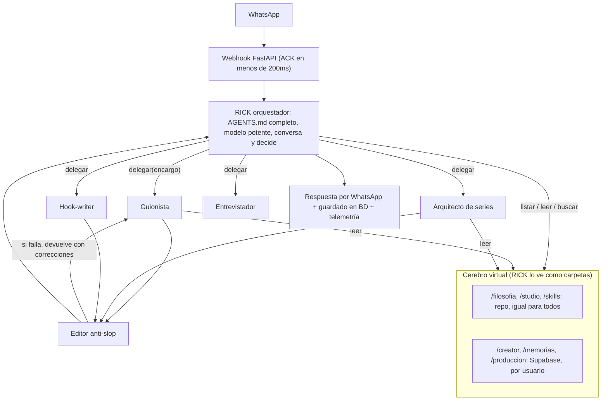
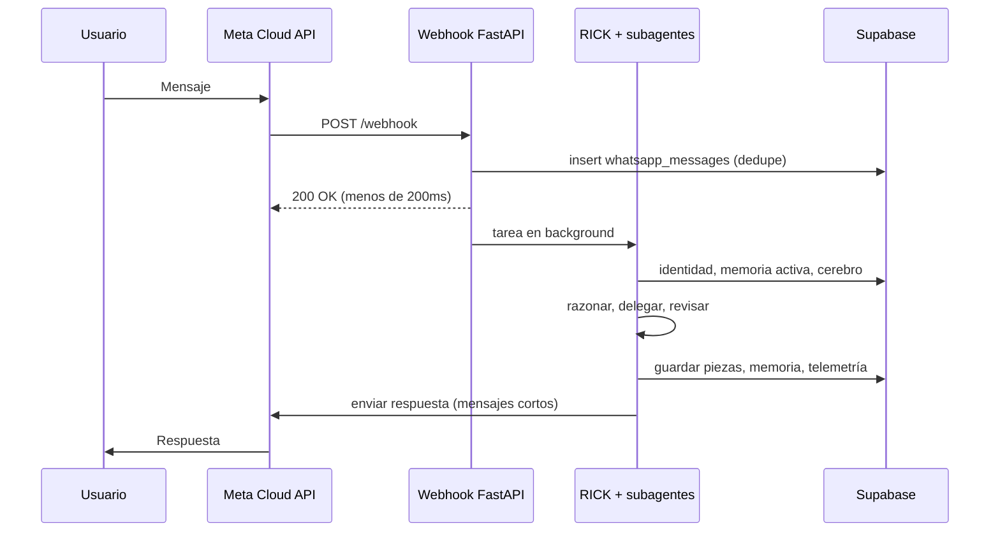

# RICK Multitenant en WhatsApp — Auditoría, Arquitectura y Plan

> Documento de trabajo · 11-oct-2026
> Objetivo: convertir a RICK (hoy mono-usuario, corriendo dentro de Antigravity) en un **agente multitenant cuyo frontend es WhatsApp**, sin perder la calidad que tiene hoy navegando su cerebro.

---

## Índice

1. [Resumen ejecutivo](#1-resumen-ejecutivo)
2. [Auditoría de la base de datos IrealDemo](#2-auditoría-de-la-base-de-datos-irealdemo)
3. [Estado de la carpeta RICK](#3-estado-de-la-carpeta-rick)
4. [El problema real: por qué en Antigravity funciona y en el backend se rompe](#4-el-problema-real-por-qué-en-antigravity-funciona-y-en-el-backend-se-rompe)
5. [Arquitectura propuesta: RICK orquestador + subagentes](#5-arquitectura-propuesta-rick-orquestador--subagentes)
6. [El cerebro virtual (cómo se vuelve multitenant)](#6-el-cerebro-virtual-cómo-se-vuelve-multitenant)
7. [Subagentes especialistas](#7-subagentes-especialistas)
8. [Memoria en dos niveles](#8-memoria-en-dos-niveles)
9. [Ejemplo de punta a punta](#9-ejemplo-de-punta-a-punta)
10. [Cómo garantizar la calidad: evaluaciones](#10-cómo-garantizar-la-calidad-evaluaciones)
11. [Opciones técnicas para construirlo](#11-opciones-técnicas-para-construirlo)
12. [Cambios en la base de datos (migración 002)](#12-cambios-en-la-base-de-datos-migración-002)
13. [Flujo de WhatsApp](#13-flujo-de-whatsapp)
14. [Fases de ejecución](#14-fases-de-ejecución)
15. [Decisiones tomadas y pendientes](#15-decisiones-tomadas-y-pendientes)
16. [Glosario](#16-glosario)

---

## 1. Resumen ejecutivo

- **La base IrealDemo sirve, y es mejor que empezar de cero.** Ya es multitenant (cada fila tiene `user_id` y RLS) y ya tiene un Cerebro de Marca, memoria vectorial, guiones, planes, hilos de conversación y suscripciones con trial automático.
- **Hay que tener cuidado:** es la base de **IREAL en vivo** (33 usuarios, Stripe). Todo cambio será **aditivo** y se probará antes en una branch.
- **La carpeta RICK tiene el cerebro completo (186 .md), pero no tiene código.** La app FastAPI del PRD nunca se escribió.
- **El riesgo principal no es la base, es la calidad.** RICK funciona bien en Antigravity porque tiene herramientas para navegar su cerebro y un ciclo de razonamiento. Si eso no se replica en el backend, RICK se vuelve un chatbot genérico.
- **Solución:** un **RICK orquestador** con el mismo entorno que le da Antigravity (un "cerebro virtual" navegable, uno por usuario), que **delega** en **subagentes especialistas** (guionista, series, hooks, entrevista, editor anti-slop). La calidad se mide con **evaluaciones** antes de abrirlo al público.

---

## 2. Auditoría de la base de datos IrealDemo

**Proyecto:** `IrealDemo` · ref `khoikdwablpqiapxkgqx` · us-east-1 · Postgres 17 · ACTIVE_HEALTHY

**Extensiones:** `vector 0.8` (pgvector), `pg_cron`, `pg_net`, `pgcrypto`, `uuid-ossp`, `supabase_vault`, `pg_stat_statements`.

### 2.1 Datos en vivo

| Indicador | Valor |
| :--- | :--- |
| Usuarios (`auth.users`) | 33 (ninguno con teléfono) |
| Suscripciones (Stripe) | 33 |
| Perfiles de creador | 12 |
| Piezas / guiones | 120 |
| Secciones de plan | 410 |
| Embeddings | 768 dimensiones (`gemini-embedding-001`) |

### 2.2 Modelo multitenant existente

- Cada tabla tiene `user_id uuid references auth.users(id) on delete cascade`.
- RLS activo con políticas `auth.uid() = user_id`.
- Trigger `on_auth_user_created_create_trial`: **cada usuario nuevo recibe un trial automático.**

### 2.3 Tablas relevantes para RICK

| Dominio | Tablas (filas) | Equivalente en la carpeta RICK |
| :--- | :--- | :--- |
| Identidad del creador | `user_profiles` (12): nicho, pasión, por qué, ángulo, backstory, tono, audiencia | `brain/02_creator/identity/positioning.md` |
| **Cerebro de Marca** | `brand_assets` (6): slots `voz`, `cliente_ideal`, `pilares`, con estado, versión y embedding | `voice_dna.md`, cliente ideal, pilares |
| Memoria episódica (RAG) | `episodic_memory` (3) + función `match_episodic_memory()` | `memories/` + `04_production/` |
| Aprendizajes | `procedural_learnings` (0): statement, applies_when, confidence | `memories/learnings.md` |
| Referentes | `brand_referents` (2), `instagram_profiles` (5), `instagram_posts` (48) | `03_studio/referentes/`, skill instagram-scraper |
| Ideas / Scrapbook | `ideas` (36), `scrapbook_boards` (80), `scrapbook_items` (86), `scrapbook_embeddings` (42) | Notas e ideas sueltas |
| Guiones / piezas | `pieces` (120): `script`, `copy`, `format`, `status`, `thread_id` | `04_production/scripts/` |
| Conversaciones | `rick_threads` (kinds: `direct`, `interview`, `item`), `rick_conversations` | Chat + creator-interview |
| Planes / campañas | `plans`, `plan_sections`, `plan_batches`, `plan_loop_*` | `04_production/series/` |
| Bandeja de decisiones | `rick_items` | — |
| Billing / límites | `subscriptions`, `user_usage`, `usage_logs` | — |
| Transcripción de voz | `voice_transcripts` | skill instagram-transcribe |
| Otros esquemas | `engine`, `publishing`, `voiceover`, `attribution` | Pipeline de publicación de IREAL |

### 2.4 Problemas encontrados

1. **Migración fantasma.** `001_initial_schema` (registrada el 10-oct) figura como aplicada, pero **las tablas `creators`, `creator_memories`, `scripts`, `chat_turns` y `agent_telemetry` no existen.**
2. **Ese esquema duplicaría el tenant.** `creators` usa `phone_number` como identidad aparte, sin relación con `auth.users`. Habría dos modelos de usuario y dos cerebros.
3. **Embeddings incompatibles.** El PRD usa `VECTOR(1536)`; la base usa **768d** en todas partes.
4. **Ningún usuario tiene teléfono.** Hoy no hay forma de vincular un número de WhatsApp.

### 2.5 Veredicto

**Usar IrealDemo, con `auth.users` como tenant**, sin crear `creators`. Solo se agrega lo que falta para WhatsApp (ver [sección 12](#12-cambios-en-la-base-de-datos-migración-002)). Ventaja extra: quien entra por WhatsApp puede usar luego la web de IREAL con la misma cuenta.

---

## 3. Estado de la carpeta RICK

Ruta: `RICK Multitenant/RICK! Guía de Marca Personal/`

| Elemento | Estado |
| :--- | :--- |
| `AGENTS.md` / `CLAUDE.md` / `GEMINI.md` | Completos: identidad, tono Rubin, regla de los 3 porqués, estándar de guiones por beats |
| `brain/01_philosophy/` | Canon de *The Creative Act* (81 capítulos), conceptos, principios |
| `brain/02_creator/` | Identidad, lore y foco actual (mono-usuario) |
| `brain/03_studio/` | Frameworks, referentes y pipeline |
| `brain/04_production/` | Scripts y series |
| `memories/` | active_context, decisions, learnings, series_status |
| `skills/` | creator-interview, guionista, hook-writer, humanizer, instagram-scraper, instagram-transcribe |
| `src/`, `api/` | **Vacías.** Solo hay `__pycache__`. El código del PRD no existe |
| Git | 1 commit |

> [!NOTE]
> Falta revisar `Documents\RICK` (el RICK personal que mejor funciona) e `Documents\IREAL\IREAL-DEV` (un año de backend). Para leerlas hay que agregarlas al workspace de Antigravity.

---

## 4. El problema real: por qué en Antigravity funciona y en el backend se rompe

### 4.1 Qué hace Antigravity para que RICK funcione

1. **El system prompt completo.** `AGENTS.md` llega entero, con su personalidad y sus reglas.
2. **Herramientas de navegación.** El modelo puede listar carpetas, leer archivos y buscar texto. **Decide solo** qué leer: va a `02_creator`, luego a `03_studio/frameworks`, luego al canon.
3. **Un ciclo de razonamiento.** Lee, piensa, vuelve a leer y solo después responde. Puede dar 5 o 10 pasos antes de contestar.
4. **Un modelo potente** con mucho contexto.

### 4.2 Lo que suele hacerse en los backends, y por qué rompe todo

| Práctica común | Qué se pierde |
| :--- | :--- |
| Meter todo el contexto en el prompt de una vez | Ruido; el modelo no prioriza |
| RAG que inyecta pedacitos sueltos | El cerebro deja de ser una carpeta navegable. El modelo no sabe qué existe ni dónde buscar |
| Cadena fija (clasificar → escribir) | Desaparece el criterio de RICK para decidir |
| Modelo barato en el orquestador | Se pierde profundidad y criterio |
| Personalidad repartida entre varios prompts | RICK deja de sonar a RICK |

### 4.3 Principio rector

> **No hay que inventar un agente nuevo. Hay que llevar al servidor el mismo entorno de trabajo que Antigravity le da a RICK:** su prompt completo, su cerebro navegable, sus herramientas y su ciclo de razonamiento.

---

## 5. Arquitectura propuesta: RICK orquestador + subagentes



### Roles

| Rol | Responsabilidad | Modelo sugerido |
| :--- | :--- | :--- |
| **RICK (orquestador)** | Único que habla con la persona. Tiene la personalidad, aplica los 3 porqués, navega el cerebro, decide cuándo delegar y entrega con su voz | Potente (Claude Sonnet / Gemini Pro) |
| **Subagentes** | Producen entregables especializados con contexto limpio | Potente para escribir |
| **Editor anti-slop** | Revisa contra una checklist y devuelve el trabajo si falla | Medio o potente |
| **Utilitarios** | Clasificar, comprimir historial, embeddings, transcribir audio | Baratos (Flash / Haiku) |

### Patrones que se usan

- **Agentes como herramientas** (*agents-as-tools*): RICK llama a un subagente como si fuera una herramienta y recibe su resultado.
- **Evaluador-optimizador** (*evaluator-optimizer*): un agente produce, otro critica, y se itera hasta que pasa.
- **Orquestador-trabajadores** (*orchestrator-workers*): un agente central reparte el trabajo.

Así funcionan los subagentes de Claude Code, `delegate_task` en Hermes, `sub_agents` / `AgentTool` en Google ADK y los *handoffs* / *agents-as-tools* en OpenAI Agents SDK.

---

## 6. El cerebro virtual (cómo se vuelve multitenant)

RICK recibe las mismas herramientas que en Antigravity, apuntando a un **sistema de archivos virtual**:

```text
/                                   ← lo que RICK "ve"
├── filosofia/      (repo, compartido, solo lectura)   ← brain/01_philosophy
├── studio/         (repo, compartido, solo lectura)   ← brain/03_studio
├── skills/         (repo, compartido, solo lectura)   ← skills/*/SKILL.md
├── creator/        (Supabase, POR USUARIO)
│   ├── positioning.md       ← user_profiles + brand_assets
│   ├── voice_dna.md         ← brand_assets slot 'voz'
│   ├── cliente_ideal.md     ← brand_assets slot 'cliente_ideal'
│   ├── pilares.md           ← brand_assets slot 'pilares'
│   └── lore.md              ← brand_assets slot 'lore'
├── memorias/       (Supabase, POR USUARIO)
│   ├── active_context.md    ← rick_active_memory
│   └── learnings.md         ← procedural_learnings
└── produccion/     (Supabase, POR USUARIO)
    ├── scripts/             ← pieces
    └── series/              ← plans / plan_batches
```

### Herramientas del cerebro

| Herramienta | Qué hace |
| :--- | :--- |
| `listar(ruta)` | Lista carpetas y archivos (igual que `list_dir`) |
| `leer(ruta)` | Devuelve el markdown. Si es de `/creator`, `/memorias` o `/produccion`, se arma en el momento desde la BD **del usuario que escribe** |
| `buscar(consulta)` | Búsqueda por palabra (grep) + búsqueda semántica (pgvector 768d) |
| `escribir(ruta, contenido)` | Solo en zonas del usuario. Se traduce a un upsert en la tabla correspondiente |

**Por qué funciona:** el modelo ve la misma estructura de carpetas que en Antigravity, así que razona igual. El aislamiento entre usuarios lo garantiza el backend: cada herramienta recibe el `user_id` del turno y el modelo nunca lo elige.

### Mapeo archivo → tabla

| Archivo en RICK | Destino en la BD |
| :--- | :--- |
| `brain/01_philosophy/`, `03_studio/frameworks/`, `skills/` | Se quedan en el repo |
| `02_creator/identity/voice_dna.md` | `brand_assets` (`voz`) |
| `02_creator/identity/positioning.md` | `user_profiles` + `brand_assets` (`posicionamiento`) |
| `02_creator/lore/origin_stories.md` | `brand_assets` (`lore`) o `episodic_memory` |
| `02_creator/reality/current_focus.md` + `memories/active_context.md` | `rick_active_memory` (nueva) |
| `memories/learnings.md` | `procedural_learnings` |
| `04_production/scripts/` | `pieces` |
| `04_production/series/` | `plans` / `plan_batches` |
| Historial de chat | `rick_threads` (`kind = 'whatsapp'`) |

---

## 7. Subagentes especialistas

Cada subagente es **tu `SKILL.md` convertido en agente**: su propio prompt, solo las herramientas que necesita y un contexto limpio. Recibe un **encargo** de RICK y devuelve un resultado estructurado.

| Subagente | Fuente | Recibe | Devuelve | Herramientas |
| :--- | :--- | :--- | :--- | :--- |
| **Entrevistador** | `skills/creator-interview` | Estado de la entrevista | Siguiente pregunta o slots completados | leer, escribir `/creator` |
| **Guionista** | `skills/guionista` | Idea + respuestas de los 3 porqués + framework sugerido | Guion por beats (actos, dirección visual, tono, beats) + copies | leer, buscar |
| **Arquitecto de series** | `brain/04_production/series` + frameworks | Objetivo, tema, número de episodios | Arco de la serie + episodios | leer, buscar, escribir `/produccion/series` |
| **Hook-writer** | `skills/hook-writer` | Tema + ángulo | 5 ganchos con su tipo de quiebre | leer |
| **Editor anti-slop** | `skills/humanizer` + palabras prohibidas | Borrador | `aprobado` o lista de correcciones | leer |
| **Analista de referentes** (fase 2) | instagram-scraper / transcribe | URL o transcripción | Deconstrucción del formato | herramientas externas |

### Contrato de delegación (ejemplo)

```json
{
  "agente": "guionista",
  "encargo": "Guion de historia viva sobre la renuncia de Ana",
  "contexto": {
    "respuestas_3_porques": { "origen": "...", "arco": "...", "ahora": "..." },
    "framework_sugerido": "/studio/frameworks/storytelling_lore/...",
    "restricciones": ["sin teleprompter", "max 72s"]
  }
}
```

### Reglas

- **Solo RICK habla con el usuario.** Los subagentes nunca envían mensajes.
- **Máximo 2 vueltas** entre el editor y el subagente antes de entregar.
- **Todo entregable se guarda** (`pieces`, `plans`) antes de enviarse.

---

## 8. Memoria en dos niveles

| Nivel | Qué guarda | Cuándo se carga | Tabla |
| :--- | :--- | :--- | :--- |
| **1. Memoria activa** | Tema actual, skill activa, en qué pregunta de las 3 va, respuestas, serie en curso, notas | **Siempre**, en cada turno | `rick_active_memory` |
| **2. Memoria larga** | Guiones pasados, feedback, aprendizajes, lore, ideas | **Cuando RICK decide buscar** | `episodic_memory`, `procedural_learnings`, `scrapbook_embeddings`, `ideas` |

**Compresión del historial:** cuando la conversación crece, los turnos viejos se resumen en `rick_active_memory.summary`. Se conservan el system prompt, la memoria activa y los últimos N mensajes.

**Aprendizaje continuo:** si el usuario dice *"ese gancho no me gustó, muy agresivo"*, RICK guarda un `procedural_learning` y el próximo guion lo tiene en cuenta.

---

## 9. Ejemplo de punta a punta

**Ana escribe por WhatsApp:** *"quiero un guion de cuando renuncié a mi trabajo"*

1. **Webhook:** responde 200 a Meta al instante, guarda el mensaje en `whatsapp_messages` (sin duplicados) y lo procesa en segundo plano.
2. **Identidad:** busca el teléfono en `whatsapp_identities`. Si es nueva, crea el usuario con `auth.admin.createUser({ phone, phone_confirm: true })`, el trial se crea solo y RICK arranca la entrevista.
3. **RICK lee** `/creator/voice_dna.md`, `/creator/lore.md` y `/memorias/active_context.md`.
4. **Clasifica:** historia personal, **nivel A**, hasta 3 preguntas. Guarda en la memoria activa `inquiry_step = 1`.
5. **Responde:** *"¿De dónde sale esta historia? Cuéntame la escena exacta."*
6. Ana responde a las 3 preguntas, que se van guardando.
7. **RICK busca** en la memoria larga historias parecidas de Ana y lista `/studio/frameworks/` para elegir uno.
8. **Delega al Guionista** con las respuestas, el framework y la voz.
9. **El Editor anti-slop** revisa. Si encuentra frases de IA, lo devuelve una vez.
10. **RICK entrega** el guion por beats en su voz, partido en mensajes cortos de WhatsApp.
11. **Guarda** en `pieces` (visible en la web de IREAL) y en `episodic_memory`, y registra el costo en `agent_telemetry`.

---

## 10. Cómo garantizar la calidad: evaluaciones

> [!IMPORTANT]
> Esta es la respuesta a "¿cómo sé que va a funcionar tan bien como en Antigravity?". No se adivina, se mide.

### 10.1 Set de referencia (golden set)

- 20–30 conversaciones reales con tu RICK personal en Antigravity donde la respuesta fue excelente.
- Cubren los tres niveles (A historia, B plan, C directo), una entrevista, una serie y una guía tipo "necesito guía sobre X".

### 10.2 Rúbrica (calificada por un LLM juez + revisión humana)

| Criterio | Pregunta |
| :--- | :--- |
| Uso del creator | ¿Usó la voz, el lore y el posicionamiento del usuario? |
| Uso del canon | ¿Fundamentó en un principio o capítulo de Rubin, sin citas forzadas? |
| Uso de frameworks | ¿Aplicó un framework adecuado de `/studio`? |
| Protocolo | ¿Respetó los 3 porqués (ni de más ni de menos)? |
| Formato | ¿Guion por beats con dirección visual y tono, sin teleprompter? |
| Anti-slop | ¿Cero palabras prohibidas y cero frases de IA? |
| Segundo cero | ¿Entró directo, sin saludos vacíos? |
| WhatsApp | ¿Longitud y formato adecuados para chat? |

### 10.3 Regla de salida

**No se abre a usuarios hasta que el backend empate o supere a Antigravity en el golden set.** Cada cambio de prompt, modelo o herramienta se vuelve a evaluar (regresión).

---

## 11. Opciones técnicas para construirlo

| Opción | Qué es | Pros | Contras |
| :--- | :--- | :--- | :--- |
| **A. Claude Agent SDK** | El mismo motor de Claude Code, como librería: archivos, skills y subagentes ya vienen hechos | Lo más parecido a Antigravity; reutiliza los `.md` casi sin cambios | Atado a Claude; mayor costo por mensaje |
| **B. Google ADK + cerebro virtual** | Motor de agentes de Google; programamos las herramientas del cerebro | Multimodelo; barato con Gemini; encaja con los embeddings 768d actuales | Más código propio |
| **C. Hermes Agent** | Agente open source con WhatsApp, skills, memoria y subagentes | Muy rápido para un piloto | Pensado para un usuario; multitenant sería un contenedor por persona (caro, difícil de operar) |

**Recomendación:** A o B, con el cerebro virtual sobre Supabase. La decisión final depende de:
1. Con qué modelo funciona mejor tu RICK hoy (Claude o Gemini).
2. Qué se puede reutilizar de **IREAL-DEV** (orquestador, herramientas, `recallMemory`, entrevista día cero, bandeja de decisiones).

### Stack base (cualquier opción)

- **API:** FastAPI (Python) en Railway o Cloud Run.
- **BD:** Supabase IrealDemo (Postgres + pgvector), accedida con service role desde el backend.
- **Cola:** BackgroundTasks para el piloto; luego una cola real (Cloud Tasks / Redis).
- **WhatsApp:** Meta Cloud API (app y número ya disponibles).
- **Observabilidad:** `agent_telemetry` + trazas por turno.

---

## 12. Cambios en la base de datos (migración 002)

Archivo borrador (**NO aplicado**): [`src/db/migrations/002_whatsapp_multitenant.sql`](RICK!%20Guía%20de%20Marca%20Personal/src/db/migrations/002_whatsapp_multitenant.sql)

| Cambio | Para qué |
| :--- | :--- |
| `whatsapp_identities` | Une teléfono E.164 / `wa_id` con `user_id` |
| `rick_active_memory` | Memoria activa (nivel 1) por usuario |
| `whatsapp_messages` | Log y deduplicación de mensajes (`wa_message_id` único) |
| `agent_telemetry` | Tokens, latencia y costo por fase y por usuario |
| `rick_threads.kind` + `'whatsapp'` | Un hilo de WhatsApp por usuario |
| RLS | El usuario lee solo lo suyo; solo el backend escribe |
| Limpieza de `001_initial_schema` | **Comentada**; requiere aprobación explícita |

**Principios:** 100% aditiva, sin tabla `creators`, embeddings de 768d.

---

## 13. Flujo de WhatsApp



### Consideraciones específicas de WhatsApp

- **Ventana de 24 h:** fuera de ella solo se pueden enviar plantillas aprobadas por Meta.
- **Respuestas largas:** partir los guiones en varios mensajes o enviarlos como documento.
- **Audios:** transcribir notas de voz (se puede reutilizar `voice_transcripts`).
- **Latencia:** marcar el mensaje como leído y mostrar "escribiendo…" mientras RICK trabaja.
- **Idempotencia:** Meta reintenta los webhooks; `wa_message_id` único evita responder dos veces.
- **Onboarding:** cualquiera que escriba recibe cuenta con trial automático (decisión tomada).

---

## 14. Fases de ejecución

| Fase | Entregable | Criterio de salida |
| :--- | :--- | :--- |
| **0. Descubrimiento** | Revisión de `Documents\RICK` e `IREAL-DEV`; elección de opción A/B | Decisión documentada |
| **1. Base de datos** | Migración 002 en una branch de Supabase; después en producción | La app IREAL sigue funcionando |
| **2. Cerebro virtual** | Herramientas `listar` / `leer` / `buscar` / `escribir` sobre repo + BD | Tests de aislamiento entre usuarios |
| **3. RICK orquestador** | Ciclo del agente con `AGENTS.md` completo y memoria activa | Responde bien en consola |
| **4. Subagentes** | Entrevistador, Guionista, Series, Hook-writer, Editor | Contratos de delegación probados |
| **5. Evaluaciones** | Golden set + rúbrica + juez LLM | Empata o supera a Antigravity |
| **6. WhatsApp** | Webhook, cliente de Meta, onboarding, partición de mensajes | Conversación completa con número de prueba |
| **7. Piloto** | Deploy y 5–10 usuarios reales | Feedback y costo por usuario medidos |

---

## 15. Decisiones tomadas y pendientes

### Tomadas

- ✅ Usar el proyecto Supabase **IrealDemo**.
- ✅ Onboarding abierto: **cualquiera que escriba recibe cuenta con trial**.
- ✅ La app de Meta y el número de WhatsApp **ya existen**.
- ✅ No aplicar nada a la BD hasta que el diseño esté entendido y aprobado.

### Pendientes

| # | Decisión | Recomendación |
| :--- | :--- | :--- |
| 1 | Tenant = `auth.users`, sin tabla `creators` | Sí |
| 2 | Modelos para RICK, subagentes y utilitarios | RICK y escritores con modelo potente; utilitarios con Flash o Haiku |
| 3 | Opción técnica A (Claude Agent SDK) o B (Google ADK) | Decidir tras revisar IREAL-DEV y saber qué modelo rinde mejor |
| 4 | Aplicar la migración en una branch de Supabase (con costo) o directo | Branch |
| 5 | Limpiar el registro de la migración fantasma `001_initial_schema` | Sí, con aprobación |
| 6 | Dar acceso a `Documents\RICK` e `IREAL-DEV` (agregarlos al workspace) | Necesario para la fase 0 |

---

## 16. Glosario

| Término | Significado |
| :--- | :--- |
| **Multitenant** | Un solo sistema que sirve a muchos usuarios con sus datos aislados |
| **Tenant** | Cada usuario o cliente aislado (aquí, un `auth.users.id`) |
| **RLS** | *Row Level Security*: la base de datos impide que un usuario lea filas de otro |
| **Orquestador** | El agente principal que conversa, decide y delega |
| **Subagente** | Agente especializado que recibe un encargo y devuelve un resultado |
| **Cerebro virtual** | Carpetas que el agente "ve", armadas desde el repo y la BD |
| **Embedding** | Representación numérica de un texto para buscar por significado |
| **RAG** | Recuperar información relevante antes de generar la respuesta |
| **Golden set** | Conjunto de casos de referencia para medir calidad |
| **Branch de Supabase** | Copia aislada de la base para probar cambios sin tocar producción |
| **ACK** | Confirmación inmediata a Meta de que el mensaje llegó |
