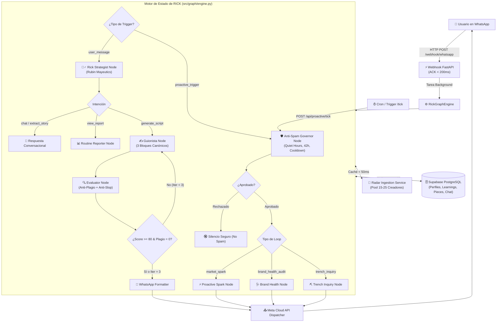
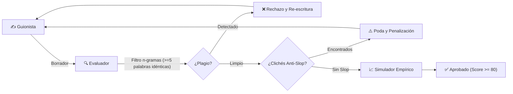
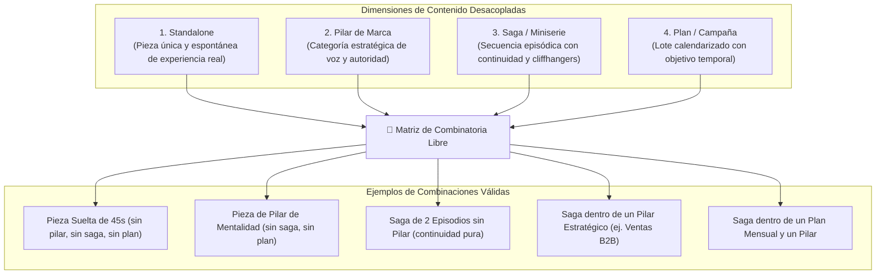

# Arquitectura del Motor RICK Multitenant Agent Engine

> **Versión del Sistema:** 1.2.0  
> **Fecha de Actualización:** Octubre 2026  
> **Estado Operativo:** Producción / Suite Completa Verificada (110 tests pasando en verde)  
> **Framework:** FastAPI + Python 3.11 + State Graph Engine (LangGraph design) + Supabase PostgreSQL  
> **Canal Principal:** Meta WhatsApp Cloud API (Outbound & Inbound con ACK $< 200$ ms)  

---

## 📑 Índice de Contenidos

1. [Resumen Ejecutivo y Estado Actual](#1-resumen-ejecutivo-y-estado-actual)
2. [Diagrama General de la Arquitectura](#2-diagrama-general-de-la-arquitectura)
3. [El Esquema de Estado Central (Core State Graph)](#3-el-esquema-de-estado-central-core-state-graph)
4. [Flujo Reactivo: Conversación y Mayéutica Basada en Experiencia Real](#4-flujo-reactivo-conversación-y-mayéutica-basada-en-experiencia-real)
5. [Flujo Proactivo: Los 4 Loops Autónomos](#5-flujo-proactivo-los-4-loops-autónomos)
6. [Gobernador Anti-Spam y Control de Cadencia](#6-gobernador-anti-spam-y-control-de-cadencia)
7. [Radar de Mercado Desacoplado y Memoria de Rotación](#7-radar-de-mercado-desacoplado-y-memoria-de-rotación)
8. [Loop de Calidad Cerrado: Evaluator-Optimizer](#8-loop-de-calidad-cerrado-evaluator-optimizer)
9. [Aislamiento Multi-Tenant y Persistencia en Supabase](#9-aislamiento-multi-tenant-y-persistencia-en-supabase)
10: [Endpoints de la API y Webhook de WhatsApp](#10-endpoints-de-la-api-y-webhook-de-whatsapp)
11. [Registro de Decisiones Arquitectónicas (ADRs)](#11-registro-de-decisiones-arquitectónicas-adrs)
12. [Arquitectura de Contenido Multidimensional (Sagas, Pilares, Planes y Piezas Sueltas)](#12-arquitectura-de-contenido-multidimensional-sagas-pilares-planes-y-piezas-sueltas)
13. [Descubrimiento Dinámico de Nicho (Apify), Enlaces de Referencia y Onboarding en 4 Etapas](#13-descubrimiento-dinámico-de-nicho-apify-enlaces-de-referencia-y-onboarding-en-4-etapas)

---

## 1. Resumen Ejecutivo y Estado Actual

El motor **RICK Multitenant Agent Engine** es un estratega y par de marca personal autónomo que opera como un miembro de equipo interno para creadores de contenido a través de WhatsApp.

A diferencia de chatbots genéricos o secuencias rígidas, RICK opera sobre un **Grafo de Estado funcional (`RickGraphEngine`)** que bifurca el procesamiento en dos canales complementarios:
1. **Canal Reactivo (Conversacional):** Ingesta de mensajes de WhatsApp en $< 200$ ms, mayéutica creativa inspirada en Rick Rubin (*The Creative Act*), extracción de anécdotas y aprendizajes reales y generación de guiones técnicos en 3 bloques canónicos con loop cerrado de calidad anti-plagio y anti-slop.
2. **Canal Proactivo (Autónomo):** Auditorías periódicas de pilares de marca, detección de anomalías virales en el mercado y preguntas de reactivación tras inactividad, todas reguladas por un **Gobernador Anti-Spam** determinista que garantiza cero spam y estricto respeto a los horarios del creador.

El código se encuentra completamente implementado en el paquete raíz `src/`, con 110 pruebas automatizadas unitarias y de integración pasando al 100%.

---

## 2. Diagrama General de la Arquitectura



---

## 3. El Esquema de Estado Central (Core State Graph)

El estado del sistema está centralizado en el modelo `GraphState` ([`src/graph/state.py`](file:///c:/Users/mgome/OneDrive/Documents/RICK%20Multitenant/src/graph/state.py)), implementado como un diccionario tipado inmutable actualizado mediante funciones puras:

```python
class GraphState(TypedDict, total=False):
    # Identidad y Tenant
    user_id: str
    creator_profile: CreatorProfile
    
    # Historial de Conversación
    messages: List[ConversationMessage]
    
    # Orquestación e Intención
    current_intent: str      # 'chat', 'extract_story', 'generate_script', 'view_report'
    trigger_type: str        # 'user_message', 'market_spark', 'brand_health_audit', 'trench_inquiry'
    story_elements: Dict[str, Any]  # 'scene', 'root_friction'
    inquiry_turn: int
    
    # Generación y Calidad de Guion
    winning_patterns: List[WinningPattern]
    script_draft: Optional[ScriptDraft]
    evaluation: Optional[EvaluationResult]
    iteration_count: int
    final_response: str
    
    # Loops Proactivos y Gobernador
    proactive_context: Dict[str, Any]
    governor_decision: Optional[GovernorDecision]
    brand_health_report: Optional[BrandHealthReport]
    proactive_spark: Optional[ProactiveSpark]
    
    # Aprendizajes y Telemetría
    learnings: List[LearningItem]
    telemetry: Dict[str, Any]
```

### Principio de Inmutabilidad
Todas las mutaciones se realizan a través de `update_state(state, **kwargs)`, devolviendo una copia superficial modificada para evitar efectos secundarios entre llamadas asíncronas.

---

## 4. Flujo Reactivo: Conversación y Mayéutica Basada en Experiencia Real

Cuando el creador escribe un mensaje a WhatsApp, el orquestador ejecuta el nodo [`src/agents/rick.py`](file:///c:/Users/mgome/OneDrive/Documents/RICK%20Multitenant/src/agents/rick.py):

### 4.1 La Matriz de Limitación Verbal de Rick Rubin
1. **Nivel 1 (Charla y Calibración):** Respuestas concisas de 30 a 60 palabras, sin cortesías corporativas ni teoría abstracta. Tono directo de cómplice y par creativo.
2. **Nivel 2 (Indagación Mayéutica de Experiencia Real):** Exactamente **una sola pregunta por turno** para extraer la escena concreta ("¿Dónde estabas exactamente?") y la fricción real ("¿Qué era lo que nadie se atrevía a decir?").
3. **Nivel 3 (Entrega de Obra Técnica):** Transición automática a la generación de guion en cuanto el creador provee escena y fricción, sin forzar turnos redundantes si el mensaje inicial ya traía ambos elementos.

---

## 5. Flujo Proactivo: Los 4 Loops Autónomos

RICK incorpora 4 bucles autónomos diseñados para intervenir proactivamente con alto valor estratégico:

| Loop | Trigger | Responsabilidad | Frecuencia / Condición |
| :--- | :--- | :--- | :--- |
| **1. `market_spark`** | Detección de Anomalía | Identifica patrones virales ($R \ge 1.5\times$) en referentes y propone un ángulo de contenido en voz de equipo ("*Ojo con este formato que explotó en nuestro nicho; podemos adaptarlo a tu tema...*"). | Diaria / Tras ingesta de anomalías |
| **2. `brand_health_audit`** | Auditoría de Pilares | Analiza la distribución temática de los últimos reels del creador y alerta si algún pilar fundacional quedó desierto ($< 15\%$). | Semanal |
| **3. `trench_inquiry`** | Silencio Creativo | Tras $\ge 42$ horas de inactividad, envía una pregunta de trinchera al final del día (17:00 a 19:30) para extraer una vivencia real y reactivar el flujo de ideas. | Ventana hábil vespertina tras 42h |
| **4. `routine_reporter`** | Rutina de Cuenta | Calcula la mediana personal del creador, detecta posts ganadores propios y extrae aprendizajes procesables (`procedural_learnings`) en Supabase. | Semanal o bajo demanda |

---

## 6. Gobernador Anti-Spam y Control de Cadencia

Implementado en [`src/graph/governor.py`](file:///c:/Users/mgome/OneDrive/Documents/RICK%20Multitenant/src/graph/governor.py), el Gobernador evalúa deterministamente si un mensaje proactivo tiene permitido enviarse:

### Reglas de Decisión:
1. **Exención al Usuario:** Los mensajes reactivos iniciados por el usuario siempre tienen permiso (`allowed = True`).
2. **Ventana Hábil General (Quiet Hours):** Notificaciones regulares solo entre **09:00 y 19:00 hora local**.
3. **Ventana de Trinchera:** La indagación `trench_inquiry` solo se emite entre **17:00 y 19:30 hora local**.
4. **Umbral de Inactividad:** Exige al menos **42 horas de silencio** del creador antes de disparar `trench_inquiry`.
5. **Umbral de Señal SNR:** Confianza mínima del patrón $\ge 0.85$.
6. **Backoff Progresivo por Ignorado:**
   - 0 silencios previos: Cooldown base (24h para chispas/salud, 42h para trinchera).
   - 1 silencio: Cooldown extendido a 48 horas.
   - 2+ silencios: Cooldown extendido a 96 horas.

---

## 7. Radar de Mercado Desacoplado y Memoria de Rotación

Implementado en [`src/services/radar_ingestion.py`](file:///c:/Users/mgome/OneDrive/Documents/RICK%20Multitenant/src/services/radar_ingestion.py) y [`src/matrix/analyzer.py`](file:///c:/Users/mgome/OneDrive/Documents/RICK%20Multitenant/src/matrix/analyzer.py):

### Principios del Radar "Wide & Fresh":
- **Cero Scraping en Vivo:** Toda la ingesta de las 10 columnas se realiza en segundo plano, indexando los datos en memoria por `user_id`. Las consultas de patrones ganadores en caliente toman **$< 50$ ms**.
- **Pool Amplio (15–25 Creadores):** Cada creador del pool aporta un máximo de 3 piezas ganadoras recientes (`sample_wide_radar`), evitando sesgo por un solo video viral.
- **Exclusión Anti-Solapamiento (30 días):** Las publicaciones usadas en guiones generados se bloquean durante 30 días (`record_used_post`).
- **Rotación de Creadores (7 días):** Referentes que inspiraron entregas recientes entran en cooldown de 7 días (`rotate_creator_patterns`), forzando diversidad en los siguientes guiones.

---

## 8. Loop de Calidad Cerrado: Evaluator-Optimizer

Implementado en [`src/agents/evaluator.py`](file:///c:/Users/mgome/OneDrive/Documents/RICK%20Multitenant/src/agents/evaluator.py) y [`src/graph/edges.py`](file:///c:/Users/mgome/OneDrive/Documents/RICK%20Multitenant/src/graph/edges.py):



### 8.1 Los 3 Bloques Canónicos de Guion
Todo guion técnico se entrega estructurado en:
- **`HOOK`**: Texto exacto de los primeros 3 segundos, Intención psicológica y Cámara frontal.
- **`DESARROLLO`**: Historia real o quiebre de creencia, Intención empática y Cámara en tono de café.
- **`CIERRE / CTA`**: Conclusión contundente sin clichés y pausa deliberada de 1 segundo.

---

## 9. Aislamiento Multi-Tenant y Persistencia en Supabase

Implementado en [`src/db/repository.py`](file:///c:/Users/mgome/OneDrive/Documents/RICK%20Multitenant/src/db/repository.py):

- **Partición estricta por `user_id`:** Mapeado desde el teléfono de WhatsApp (`user_id = f"wa_{sender_phone}"`).
- **Row-Level Security (RLS):** Consultas indexadas y filtradas exclusivamente por `.eq("user_id", user_id)`.
- **Persistencia de Conversación Multi-Turno:** Métodos `save_message` y `get_conversation` para conservar el hilo entre llamadas webhook independientes.
- **Aprendizajes Procedimentales:** Almacenamiento de feedback explícito en `procedural_learnings` para retroalimentar futuros guiones.

---

## 10. Endpoints de la API y Webhook de WhatsApp

La aplicación FastAPI ([`src/api/app.py`](file:///c:/Users/mgome/OneDrive/Documents/RICK%20Multitenant/src/api/app.py)) expone:

| Método | Ruta | Propósito | SLA / Comportamiento |
| :--- | :--- | :--- | :--- |
| `GET` | `/health` | Diagnóstico de salud de BD y memoria RAM del sistema. | Inmediato ($< 10$ ms) |
| `GET` | `/webhook/whatsapp` | Verificación del challenge de Meta (`hub.verify_token`). | Inmediato ($< 10$ ms) |
| `POST` | `/webhook/whatsapp` | Ingesta de mensajes de usuarios desde Meta Cloud API. | **ACK $< 200$ ms** + `BackgroundTasks` |
| `POST` | `/api/proactive/tick` | Disparo de ciclos proactivos por Cron/Worker externo con paso obligado por el Gobernador. | Evalúa gobernador y despacha si procede |

---

## 11. Registro de Decisiones Arquitectónicas (ADRs)

Para comprender el razonamiento histórico, alternativas descartadas y compromisos de cada decisión técnica, consulte los ADRs oficiales:

- [**ADR-001:** Arquitectura de State Graph para el Motor de RICK](file:///c:/Users/mgome/OneDrive/Documents/RICK%20Multitenant/docs/decisions/ADR-001-state-graph-architecture.md)
- [**ADR-002:** Gobernador Anti-Spam y Cadencia de Loops Proactivos](file:///c:/Users/mgome/OneDrive/Documents/RICK%20Multitenant/docs/decisions/ADR-002-anti-spam-governor-proactive-loops.md)
- [**ADR-003:** Inversión del Radar de Mercado e Ingesta Desacoplada](file:///c:/Users/mgome/OneDrive/Documents/RICK%20Multitenant/docs/decisions/ADR-003-decoupled-radar-ingestion-cache.md)
- [**ADR-004:** Bucle Evaluador-Optimizador Anti-Plagio y Anti-Slop](file:///c:/Users/mgome/OneDrive/Documents/RICK%20Multitenant/docs/decisions/ADR-004-evaluator-optimizer-quality-loop.md)
- [**ADR-005:** Aislamiento Multi-Tenant y Persistencia de Sesión](file:///c:/Users/mgome/OneDrive/Documents/RICK%20Multitenant/docs/decisions/ADR-005-multi-tenant-supabase-isolation.md)
- [**ADR-006:** Muestreo Amplio de Radar y Exclusión Anti-Solapamiento](file:///c:/Users/mgome/OneDrive/Documents/RICK%20Multitenant/docs/decisions/ADR-006-wide-fresh-radar-sampling.md)
- [**ADR-007:** Arquitectura de Contenido Multidimensional: Sagas, Pilares y Planes](file:///c:/Users/mgome/OneDrive/Documents/RICK%20Multitenant/docs/decisions/ADR-007-multidimensional-content-architecture.md)
- [**ADR-008:** Descubrimiento Dinámico de Nicho vía Apify, Ingesta de Referencias y Onboarding en 4 Etapas](file:///c:/Users/mgome/OneDrive/Documents/RICK%20Multitenant/docs/decisions/ADR-008-apify-niche-discovery-and-conversational-onboarding.md)
- [**ADR-009:** Despliegue en DigitalOcean Droplet con Docker y Canales Duales (Telegram + WhatsApp)](file:///c:/Users/mgome/OneDrive/Documents/RICK%20Multitenant/docs/decisions/ADR-009-digitalocean-droplet-docker-deployment-and-telegram-bot.md)

---

## 12. Arquitectura de Contenido Multidimensional (Sagas, Pilares, Planes y Piezas Sueltas)

La versión `1.1.0` de RICK introduce el desacople total de las dimensiones de contenido para erradicar las jerarquías forzadas de herramientas tradicionales. Un creador en WhatsApp puede generar contenido de manera espontánea sin verse obligado a categorizar cada pensamiento en un plan de marketing o pilar previo.

### 12.1 Matriz de Combinatoria Libre

Cualquier combinación de las 4 dimensiones es válida y nativamente soportada:



### 12.2 Modelos de Dominio Pydantic V2 (`src/graph/state.py`)

Para garantizar tipado estricto y serialización JSON sin mutación de estado:

```python
class SeriesMetadata(BaseModel):
    """Metadatos de continuidad episódica para sagas y miniseries."""
    series_id: str = Field(..., description="ID canónico de la saga")
    series_title: str = Field(..., description="Título de la serie")
    episode_index: int = Field(..., description="Número de episodio (1-indexed)")
    total_episodes: Optional[int] = Field(default=None, description="Total planeado de episodios")
    previous_piece_id: Optional[str] = Field(default=None, description="ID del episodio anterior")
    next_piece_id: Optional[str] = Field(default=None, description="ID del siguiente episodio")

class ScriptDraft(BaseModel):
    """Guion técnico estructurado en 3 bloques con metadatos multidimensionales opcionales."""
    titulo: str
    formato: str = "Reel"
    duracion_objetivo: int = 45
    hook: ScriptBlock
    desarrollo: ScriptBlock
    cierre: ScriptBlock
    # Dimensiones opcionales con default None (100% retrocompatible)
    pilar: Optional[str] = None
    series: Optional[SeriesMetadata] = None
    plan_id: Optional[str] = None
```

### 12.3 Persistencia y Mapeo No Destructivo en Supabase (`public.pieces`)

La persistencia en PostgreSQL aprovecha las columnas ya existentes en `public.pieces` sin requerir DDL destructivo ni migraciones de esquema:

| Campo en `ScriptDraft` | Columna en `public.pieces` | Tipo PostgreSQL | Comportamiento si es `None` |
| :--- | :--- | :--- | :--- |
| `script.pilar` | `strategy_tag` | `text` (nullable) | Almacena `NULL` (pieza suelta sin pilar) |
| `script.plan_id` | `plan_id` | `uuid` (nullable) | Almacena `NULL` (sin plan asociado) |
| `script.series` | `idea_fields` | `jsonb` (default `{}`) | Almacena `idea_fields["series"] = series.model_dump()` o `{}` |
| `script` completo | `script` | `jsonb` (not null) | Serialización íntegra del guion técnico |

#### Retrocompatibilidad Garantizada:
- Las **132 piezas históricas** y los **33 usuarios existentes** no tienen la llave `series` en `idea_fields`, por lo que el repositorio las trata automáticamente como piezas sueltas (`standalone`).
- **Cero bloqueos de esquema:** Al utilizar la columna JSONB nativa `idea_fields`, el sistema no requiere ejecutar sentencias `ALTER TABLE` que puedan bloquear la tabla en caliente en entornos de producción.

### 12.4 Consultas Aisladas por Tenant en `SupabaseRepository`

Para evitar cualquier fuga de datos cross-tenant (*cross-contamination*):

- **`get_series_pieces(user_id: str, series_id: str)`:**
  Filtra estrictamente por `.eq("user_id", user_id)` y recupera únicamente los episodios pertenecientes al usuario, ordenados cronológicamente por `episode_index`. Ningún creador puede consultar episodios de series de otro usuario, incluso si conoce el `series_id`.
- **`get_pillar_pieces(user_id: str, pilar_name: str)`:**
  Filtra por `.eq("user_id", user_id).eq("strategy_tag", pilar_name)`, garantizando que el creador solo acceda a su propia biblioteca de contenido por pilar.

### 12.5 Continuidad Narrativa y Cliffhangers en el Guionista (`src/agents/guionista.py`)

El nodo guionista adapta dinámicamente la estructura narrativa:

1. **Episodio 1 de Saga:**
   - **Hook:** Gancho con pegada inmediata del problema.
   - **Cierre / CTA:** Cliffhanger explícito hacia el siguiente episodio (*"En la parte 2 te cuento la solución definitiva. Sígueme para no perdértela"*).
2. **Episodio 2+ de Saga:**
   - **Hook:** Enlace retrospectivo de continuidad con la entrega anterior (*"Ayer vimos la entrega anterior de X. Hoy en la parte 2: ..."*).
   - **Cierre:** Si no es el último episodio, cliffhanger hacia el siguiente; si es el último episodio, cierre de arco de la saga y llamado a guardar la serie completa.
3. **Pieza Única (Standalone):**
   - Mantiene la estructura canónica pura de 3 bloques sin menciones episódicas artificiales.

### 12.6 Mayéutica Conversacional en WhatsApp (`src/agents/rick.py`)

RICK opera con la mayéutica socrática de Rick Rubin, guiando al creador sin imponer formatos:

1. **Detección de Historias Multi-Punto:**
   Si el creador relata una experiencia con múltiples quiebres o lecciones (ej. *"dos errores graves"*, *"tres problemas"*), RICK reconoce que comprimir todo en 45 segundos diluiría la pegada del video.
2. **Propuesta Creativa de Socio:**
   En lugar de decidir unilateralmente, RICK pregunta en tono de par:
   > *"¿Hacemos una sola pieza al grano o te parece si armamos una saga de 2 partes?"*
3. **Respeto a la Decisión del Creador:**
   - Si el usuario responde *"una sola pieza"* o *"al grano"*, RICK genera inmediatamente el guion autoconclusivo sin insistir.
   - Si responde *"saga de 2 partes"* o *"miniserie"*, RICK estructura la saga, genera el Episodio 1 con metadatos `SeriesMetadata` y prepara el terreno para el Episodio 2.

---

## 13. Descubrimiento Dinámico de Nicho (Apify), Enlaces de Referencia y Onboarding en 4 Etapas

La versión `1.2.0` de RICK revoluciona la captación de benchmark de mercado y la bienvenida al creador, eliminando por completo cualquier jerga militar o artificial (*"trinchera"*):

### 13.1 Scraper Dinámico de Reels vía Apify (`src/services/instagram_scraper.py`)
En lugar de depender exclusivamente de cuentas fijas precargadas, el servicio `InstagramScraperService` utiliza el actor de Apify `clockworks~instagram-reels-scraper` para buscar reels virales en tiempo real según los tópicos del creador:
- **`search_niche_reels(keywords, max_reels=15)`:** Retorna URLs reales de Instagram Reels, nombres de usuario, fecha, visualizaciones, likes, comentarios y captions.
- **`scrape_shared_link(url)`:** Inspecciona un reel específico cuando el creador comparte un enlace directo en la conversación.
- **Modo Offline / CI:** Cuenta con un mock determinista para pruebas automáticas y entornos sin credenciales configuradas, garantizando pruebas 100% confiables en $< 1.5$s.

### 13.2 Ingesta y Caché Sub-50ms en el Radar (`src/services/radar_ingestion.py`)
Los reels descubiertos se indexan en el radar calculando la mediana de visualizaciones del nicho y el multiplicador de rendimiento relativo $R = \text{views}/\text{median}$. Aquellos con $R \ge 1.5\times$ son marcados como anomalías ganadoras y quedan disponibles de inmediato para fundamentar propuestas de contenido sin latencia perceptible.

### 13.3 Ingesta de Enlaces Compartidos en WhatsApp (`src/agents/rick.py`)
El clasificador de intenciones (`classify_intent`) incluye el tipo `share_reference_link`. Al recibir un link de Instagram Reel:
1. RICK extrae la URL y consulta sus métricas.
2. Analiza el gancho, la retención y el ángulo psicológico del video.
3. Devuelve al usuario un desglose directo en WhatsApp con ideas para adaptarlo a su propia voz y contexto profesional.

### 13.4 Secuencia de Onboarding Canónica en 4 Etapas (`src/agents/prompts.py`)
Para nuevos creadores, RICK ejecuta una secuencia conversacional metódica:
1. **Etapa 1 (Apertura y Oferta de Prueba):**
   > *"Tu prueba corre por mi cuenta: después de que trabajemos juntos un tiempo, seguro que te vas a convencer de seguir trabajando conmigo. ¿Cuáles son tus redes? Déjame ver qué has estado haciendo 📲"*
2. **Etapa 2 (Diagnóstico de Huella & Pregunta 1):**
   RICK revisa sus perfiles y lanza la primera pregunta estratégica:
   > *"¿Qué quieres lograr con tu marca personal? ¿Cuál es tu objetivo?"*
3. **Etapa 3 (Cosmovisión & Pregunta 2):**
   Indaga sobre las mentiras comunes de su industria, mitos o posturas contraintuitivas que defiende con base en su experiencia práctica real.
4. **Etapa 4 (Perfilado, Validación y 3 Opciones de Video):**
   Sintetiza el perfil (Público Objetivo, Objetivo, Nicho, Posturas, Tono), valida con el creador y entrega 3 conceptos de video fundamentados con enlaces reales de Instagram descubiertos por el radar.

### 13.5 Política Estricta de Cero Falsas Promesas
Se prohíbe terminantemente prometer herramientas o dashboards inexistentes (como placeholders `[link]` o paneles web). Toda la inteligencia de mercado, ganchos y guiones se entregan de forma limpia y directa en el chat de WhatsApp.

