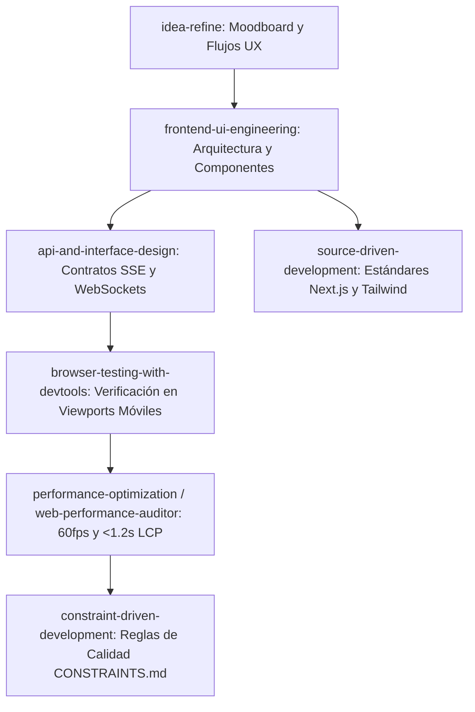

# 🎨 RICK Studio: Frontend Architecture & Creator-First UX Design

---

## 📸 Concepto Visual de Alta Fidelidad

A continuación se muestra el diseño conceptual de la interfaz móvil adaptada específicamente para **creadoras de contenido, influencers y marcas personales no técnicas**:


---

## 🎯 1. Filosofía de Producto: "Copilot, Not Autopilot" para Creadores

A diferencia de herramientas técnicas diseñadas para programadores (como Linear o Jira), los creadores de contenido e influencers son **extremadamente celosos de su estilo, estética y tono personal**. 

Nuestra investigación de las mejores prácticas de la industria en 2025/2026 demuestra que las interfaces de IA para creadores deben seguir **cinco mandamientos inquebrantables**:

### 1. Cero Jerga Técnica (Mapeo al Modelo Mental del Creador)
El motor de Rick corre frameworks de guionismo (`PAS`, `AIDA`, `Doble Codificación de Paivio`), pero la pantalla **nunca** muestra esa jerga:
* En vez de *"Gancho de Retención Audiovisual"* $\rightarrow$ **🎯 Gancho de 3 segundos**.
* En vez de *"Agitación del Problema / Fricción"* $\rightarrow$ **☕ El Chisme / El Drama**.
* En vez de *"Solución Contracorriente"* $\rightarrow$ **✨ La Revelación / Momento Mágico**.
* En vez de *"Frictionless CTA"* $\rightarrow$ **💬 El Cierre & Pregunta a la Comunidad**.
* En vez de *"Subagente Anti-Slop Editor"* $\rightarrow$ **💅 "Calibrando a tu vibra auténtica..."**.

### 2. Edición "Inline" por Bloques (Micro-Ajustes sin Fricción)
Un creador nunca quiere pedirle a la IA que reescriba todo el guion desde cero si solo le disgustó el final. 
* Cada tarjeta del guion permite un tap rápido para abrir un **Bottom Sheet (hoja inferior)** con opciones de 1 toque:
  * *"Más picante / polémico"*
  * *"Más corto"*
  * *"Cambiar por otra anécdota"*
  * *"Dictar con mi voz este pedazo"*

### 3. Voice-First & Multimodalidad Fluida
Los creadores piensan en voz alta mientras se maquillan, manejan o caminan. Escribir en teclados móviles pequeños mata la creatividad.
* **Floating Voice Pill:** Una píldora o esfera flotante interactiva en la parte inferior de la pantalla que late en sincronía con la voz del usuario.
* **Speech-to-Structured-Cards:** El usuario dicta libremente: *"Rick, quiero hacer un video sobre por qué dejé de usar base líquida y ahora uso serum con color"*, y el frontend transforma ese audio directamente en las 4 tarjetas Bento visuales en la pantalla.

### 4. Ergonomía en la "Zona del Pulgar" (Thumb-Zone)
* El 90% de las acciones críticas (grabar nota de voz, afinar una idea, copiar el guion) están ubicadas en el **tercio inferior de la pantalla**, accesibles con una sola mano sin forzar el pulgar.
* Modales rígidos reemplazados por **Interactive Bottom Sheets** deslizables hacia abajo.

### 5. Estética Editorial de Lujo (Calm Dark Mode)
* Fondo base: Capas de gris carbón suave (`#0f0f12`, `#18181b`) en lugar de negro puro `#000000` (evita fatiga visual).
* Acentos cromáticos: Tonos lavanda suave, durazno champagne y oro cálido.
* Tarjetas Bento con bordes redondeados (`rounded-3xl`), sutiles reflejos de luz y desenfoque de fondo glassmorphic (`backdrop-blur-md`).

---

## 🛠️ 2. ¿Qué Skills de Agent Skills Usaremos en el Frontend?

Para construir este frontend con excelencia técnica y de diseño, utilizaremos el siguiente conjunto coordinado de skills:



### 1. `idea-refine` & `interview-me`
* **Para qué:** Mapear los flujos de creación paso a paso (desde que la creadora tiene una idea vaga en un audio hasta que el guion queda listo y aprobado).
* **Entregable:** Mapa de estados de la interfaz y paleta de tokens semánticos de diseño.

### 2. `frontend-ui-engineering` ⭐ *(Skill Reina de Implementación)*
* **Para qué:** Desarrollar los componentes modulares y el sistema de diseño en React / Tailwind.
* **Componentes clave a construir:**
  * `<BentoCard />`: Tarjeta táctil con micro-animaciones al presionar.
  * `<VoiceOrb />`: Esfera pulsante de Web Audio API conectada a Whisper.
  * `<ScriptDetailModal />`: Vista limpia del guion con botón de 1-tap para copiar al portapapeles.
  * `<StoryCarousel />`: Navegación horizontal tipo Instagram Stories para pasar de acto en acto.

### 3. `api-and-interface-design`
* **Para qué:** Definir la comunicación entre FastAPI (backend) y la PWA (frontend).
* **Entregable:** Contrato de streaming con **Server-Sent Events (SSE)** para ver a Rick escribir en tiempo real, y suscripciones de **Supabase Realtime** para sincronizar cambios entre WhatsApp, Telegram y la App.

### 4. `browser-testing-with-devtools`
* **Para qué:** Ejecutar Chrome DevTools en modo emulación móvil (iPhone 15 Pro, Pixel 8) para auditar:
  * Desbordes horizontales no deseados.
  * Comportamiento del teclado virtual sobre los campos de texto.
  * Tamaño táctil mínimo de botones ($\ge 44 \times 44\text{ px}$).

### 5. `web-performance-auditor` & `performance-optimization`
* **Para qué:** Garantizar que la app móvil se sienta instantánea:
  * Animaciones a **60 fps constantes** con `framer-motion` o CSS puro.
  * LCP (Largest Contentful Paint) $< 1.2\text{ segundos}$ en conexiones 4G móviles.

### 6. `constraint-driven-development`
* **Para qué:** Fijar en `CONSTRAINTS.md` las reglas de UI innegociables:
  * Prohibición absoluta de mostrar mensajes crudos de error de API al usuario.
  * Cumplimiento de contraste WCAG AA en textos.
  * Soporte obligatorio de instalación offline (PWA Service Worker).

---

## 📚 3. ¿Qué Conceptos y Sitios Debes Aprender y Buscar?

Si no vienes del mundo de diseño, no necesitas aprender a usar Figma desde cero. Solo necesitas saber **qué buscar y dónde encontrar los mejores patrones**:

### A. Dónde robar inspiración legalmente (Las mejores plataformas)
1. **[Mobbin.com](https://mobbin.com)**:
   * Busca flujos en apps como:
     * **CapCut & TikTok Studio** (ver cómo guían a creadores paso a paso).
     * **BeReal & Lapse** (aprender sobre interfaces limpias y espontáneas).
     * **Opal & Headspace** (ver cómo usan paletas suaves, esferas de respiración y modales amigables).
2. **[Dribbble.com](https://dribbble.com)**:
   * Palabras clave de búsqueda recomendadas:
     * `"AI voice assistant mobile app"`
     * `"Creator scriptwriter UI"`
     * `"Bento grid mobile app iOS"`
     * `"Interactive script cards UI"`
3. **[Curated.design](https://www.curated.design)** y **[Godly.website](https://godly.website)**:
   * Inspiración sobre tipografía de lujo (serif contemporánea + sans-serif geométrica) y contrastes de color editoriales.

### B. Los 5 Conceptos de Diseño de Frontend que debes dominar:
1. **Bento Grid**: Arquitectura modular inspirada en las cajas de comida japonesas ("Bento boxes"). Divide la pantalla en cajitas auto-contenidas con esquinas súper redondeadas (`rounded-2xl` / `rounded-3xl`).
2. **Dynamic Island / Floating Pills**: Elementos que flotan en la pantalla sin bordes pesados, dando sensación de modernidad y ligereza.
3. **Glassmorphism**: Efecto de vidrio esmerilado translúcido usando `backdrop-filter: blur(16px)` con un borde blanco ultra-fino (`border border-white/10`). Da sensación de alta gama.
4. **Haptic Feedback & Micro-interactions**: Pequeñas vibraciones o animaciones de escala (ej. la tarjeta se encoge un 3% al tocarla) que hacen que la app se sienta física y viva.
5. **Progressive Web App (PWA)**: Permite que la web se guarde en la pantalla de inicio del iPhone/Android con su propio icono, pantalla completa (sin la barra de Safari) y funcionamiento como una app nativa sin pagar comisiones a Apple/Google.

---

## 🗺️ 4. Roadmap de Construcción del Frontend

```
Paso 1: Setup PWA & Tokens de Color (Next.js 15 + Tailwind CSS v4 + Outfit Font)
Paso 2: Componente Bento Grid para los 4 Actos del Guion
Paso 3: Esfera de Audio Interactiva (Voice Orb) conectada al endpoint de Whisper
Paso 4: Conexión Supabase Realtime (Sincronización Telegram <-> Web en vivo)
Paso 5: Exportación y Copiado Rápido de Guion (1-Tap Copy & Share)
Paso 6: Auditoría de Rendimiento Móvil y PWA install prompt
```

Este documento queda como la **guía maestra de referencia** para cuando decidamos iniciar la construcción visual de RICK Studio.
