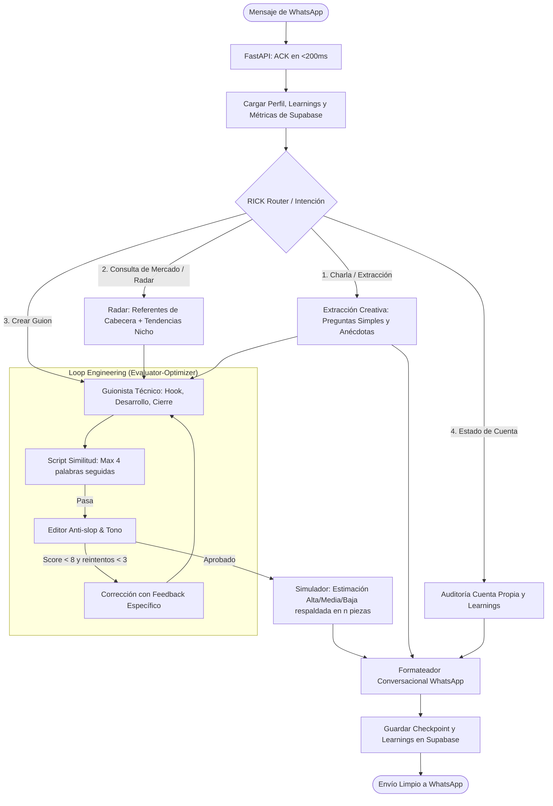

# Master Plan: RICK Multitenant Agent Engine
## Estratega de Marca Personal con Graph & Loop Engineering y Matriz de Contenido

> **Estado:** Especificación Validada  
> **Fecha:** 18 de Octubre, 2026  
> **Target:** Backend FastAPI + Supabase (`IrealDemo`) + WhatsApp Webhook  

---

## 1. Visión del Agente: Un Estratega de Marca Real

RICK no es un generador de texto; es un **estratega de marca personal proactivo** que combina:
1. **Extracción Creativa (Rick Rubin):** Conversación previa, preguntas simples y mayéutica para sacar las historias, lecciones y verdades genuinas del creador.
2. **Rigor Técnico del Guion:** Estructura limpia de tres bloques (**Hook**, **Desarrollo**, **Cierre / CTA**), con `Texto` hablado (auditado contra plagio con `similitud.mjs`), `Intención` psicológica y dirección de `Cámara`.
3. **Doble Radar de Mercado:**
   - *Referentes de Cabecera:* Monitoreo de las cuentas que el creador admira (guardadas en `brand_referents`).
   - *Radar de Nicho (Discovery):* Detección de qué temas, formatos y ganchos están rompiendo la mediana en el sector en general hoy.
4. **Auditoría de Cuenta Propia y Aprendizajes (`Learnings`):**
   - RICK analiza proactivamente el Instagram del propio creador.
   - Calcula su mediana y detecta qué piezas propias funcionaron.
   - Entrega un reporte estratégico semanal por WhatsApp y guarda los `learnings` en Supabase (`procedural_learnings`) para retroalimentar los futuros guiones.
5. **Entrega Natural en WhatsApp:** Cero asteriscos raros o tablas complejas. Mensajes limpios, conversados y concisos, como los enviaría un socio o director creativo.

---

## 2. Capability Map (Módulos del Sistema)

```
┌─────────────────────────────────────────────────────────────┐
│ 1. core-state (State Schema, Perfil Creador, Turnos)        │
└──────────────┬───────────────────────────────┬──────────────┘
               │                               │
               ▼                               ▼
┌──────────────────────────────┐ ┌─────────────────────────────┐
│ 2. storage-supabase          │ │ 3. matrix-engine            │
│ (RLS, Referentes, Learnings) │ │ (Medianas, 10 Col, Patrones)│
└──────────────┬───────────────┘ └─────────────┬───────────────┘
               │                               │
               └───────────────┬───────────────┘
                               ▼
               ┌───────────────────────────────┐
               │ 4. rick-strategist            │
               │ (Extracción, Tono Rubin, Mayéutica)│
               └───────────────┬───────────────┘
                               ▼
               ┌───────────────────────────────┐
               │ 5. script-writer              │
               │ (Hook, Desarrollo, Cierre)    │
               └───────────────┬───────────────┘
                               ▼
               ┌───────────────────────────────┐
               │ 6. evaluator-loop             │
               │ (Anti-slop, Similitud, Simulación)│
               └───────────────┬───────────────┘
                               ▼
               ┌───────────────────────────────┐
               │ 7. routine-reporter           │
               │ (Auditoría Propia, Reporte Semanal)│
               └───────────────┬───────────────┘
                               ▼
               ┌───────────────────────────────┐
               │ 8. channel-whatsapp           │
               │ (FastAPI, Webhook, ACK <200ms)│
               └───────────────────────────────┘
```

---

## 3. Arquitectura del Grafo (Graph Engineering)



---

## 4. Estándar Oficial del Guion (Hook, Desarrollo, Cierre)

El guion no usa términos distractores ("beats"). Utiliza la estructura técnica limpia:

```text
GUION: [TÍTULO CORTO]
Formato: [Reel / TikTok] · Duración Objetivo: [NN segundos]

HOOK
• Texto: "[Frase exacta y potente para detener el scroll sin saludos ni rodeos]"
• Intención: "[Efecto psicológico: desarmar objeción, tocar dolor o crear intriga]"
• Cámara: "[Plano medio cerrado, mirada directa al lente]"

DESARROLLO
• Texto: "[La historia real o el aprendizaje del creador, en lenguaje hablado de socio a socio]"
• Intención: "[Construir autoridad, vulnerabilidad o quiebre de creencia]"
• Cámara: "[Corte a plano cerrado o apoyo visual]"

CIERRE / CTA
• Texto: "[Conclusión contundente o llamado a la acción suave sin clichés de marketing]"
• Intención: "[Fijar la idea central]"
• Cámara: "[Pausa de 1 segundo antes del corte]"
```

* **Validación Anti-Plagio:** El campo `Texto` pasa por el script `similitud.mjs`. Si hay 5 o más palabras idénticas a un video referente, el loop lo reescribe automáticamente.

---

## 5. El Formato de Entrega en WhatsApp (Conversacional y Sucinto)

En WhatsApp, RICK entrega el guion de forma limpia y habla como un socio:

> Mira, aquí tienes el guion listo para grabar:
> 
> **HOOK**  
> *"Le pagué dos mil dólares a una agencia para que me salvara el negocio... y casi me lo quiebra."*  
> *(Cámara: Primer plano, directo al lente)*
> 
> **DESARROLLO**  
> *"El error no fue de ellos. Fue mío, por querer comprar clientes con dinero en vez de entenderlos con tiempo. Si tú no sabes vender tu propuesta en una servilleta, ninguna agencia lo va a hacer por ti."*  
> *(Cámara: Tono de café, como hablándole a un socio)*
> 
> **CIERRE**  
> *"Antes de pagar para escalar, asegúrate de que tienes algo que funciona cuando estás tú solo."*  
> *(Cámara: Pausa antes de cortar)*
> 
> 💡 *Lo calibré contra 5 videos de tus referentes que rompieron su mediana con este mismo patrón de confesión. Le doy un 9.4/10 de probabilidad porque la estructura está probadísima y las palabras son 100% tu historia real.*

---

## 6. Módulo de Rutina Semanal y Learnings (`routine-reporter`)

* **Auditoría de tu cuenta:**
  - RICK monitorea tus propios reels y calcula tu mediana personal de views.
  - Compara cada publicación nueva: si superó tu mediana ($>1.5\times$), analiza qué hook y tema usaste.
* **Reporte Semanal (1 o 2 veces por semana):**
  - Envía un resumen conciso por WhatsApp con métricas y aprendizajes.
  - Guarda en `procedural_learnings` de Supabase:
    `statement`: *"Las confesiones de errores en tu negocio te dan 2.2x más retención que los tutoriales técnicos."*
    `applies_when`: *"Planificación de guiones semanales."*
  - Este learning se inyecta automáticamente en el State para los próximos guiones.

---

## 7. Despliegue en Producción y Garantía de Disponibilidad (`shipping-and-launch`)

Para que RICK pueda recibir webhooks reales de WhatsApp desde cualquier lugar, el backend debe quedar desplegado en un entorno con HTTPS público y alta disponibilidad:

1. **Containerización (`Dockerfile`):**
   - Imagen ligera multi-stage en Python 3.11-slim.
   - Servidor ASGI optimizado: `uvicorn src.api.app:app --host 0.0.0.0 --port $PORT --workers 2`.
2. **Plataforma de Despliegue:**
   - Despliegue en producción con SSL automático (Google Cloud Run / Vercel Serverless / Railway) que escale a cero y responda con latencia ultrabaja.
3. **Endpoints de Producción Requeridos:**
   - `GET /health`: Healthcheck que valida conexión a Supabase y estado de memoria.
   - `GET /webhook/whatsapp`: Verificación de webhook de Meta (Challenge token).
   - `POST /webhook/whatsapp`: Recepción de eventos con ACK <200ms y BackgroundTasks.
4. **Smoke Test en Vivo:**
   - Verificación automatizada enviando un payload HTTP real contra la URL desplegada en producción y confirmando respuesta 200 y procesamiento correcto.

---

## 8. Ecosistema de Agent Skills y Contrato de Calidad Extrema

La ejecución del proyecto activará de forma obligatoria el conjunto completo de **Agent Skills** del plugin:

| Skill | Aplicación Concreta en RICK | Verificación Obligatoria |
| :--- | :--- | :--- |
| **`git-workflow-and-versioning`** | Branching trunk-based (`feature/rick-agent-engine`). Commits atómicos por tarea (`feat:`, `test:`, `refactor:`). Cero commits monolíticos. | Historial limpio en `git log --oneline` y merge final a `main`. |
| **`security-and-hardening`** | Validación HMAC de firma de WhatsApp, sanitización Pydantic, aislamiento estricto de tenant en Supabase (RLS por `user_id`), cero secretos en repo. | Auditoría con subagente `security-auditor` y escaneo `pip-audit`. |
| **`performance-optimization`** | SLA de WhatsApp: ACK $<200\text{ ms}$ garantizado mediante `BackgroundTasks`. Consultas asíncronas indexadas en Supabase y caché de patrones. | Benchmark de latencia en tests de webhook. |
| **`code-review-and-quality`** | Revisión multi-eje (corrección, legibilidad, arquitectura, seguridad, performance) en cada Checkpoint. | Aprobación del subagente `code-reviewer`. |
| **`code-simplification`** | Refactorización de código redundante tras poner los tests en verde para mantener la base concisa y mantenible. | Reducción de complejidad ciclomática y cero duplicación. |
| **`observability-and-instrumentation`** | Logs estructurados JSON, conteo de tokens consumidos por nodo y medición de latencias. | Trazas observables en terminal y registros de sesión. |
| **`test-driven-development`** | Bucle estricto Red -> Green -> Refactor. Cobertura de pruebas unitarias e integración $>85\%$. | Suite `pytest -v tests/` 100% verde en cada checkpoint. |


