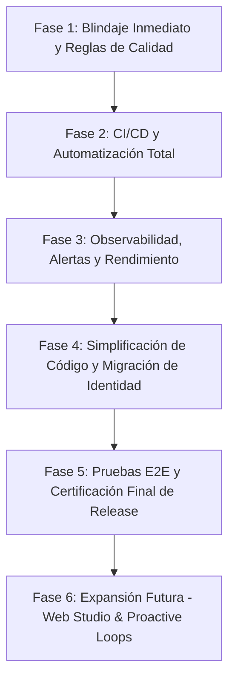

# 📋 Plan Maestro de Pulido Integral y Blindaje de RICK (Agent Skills)

---

## 🧭 Diagnóstico de Suficiencia: ¿Qué tenemos hoy y qué falta realmente?

### 1. Lo que ya está 100% construido y funcionando en producción:
- ✅ **Motor Multimodal:** Transcripción de audios con OpenAI Whisper-1 y fallback Gemini 2.5 Flash.
- ✅ **Cerebro Orquestador:** GPT-4o con personalidad *Head of Content*, tool calling determinista y anti-rotura de la cuarta pared.
- ✅ **Pipeline de 3 Subagentes:** 
  1. `HookWriter` (quiebre cognitivo y ganchos de retención).
  2. `Guionista` (5 actos, intención psicológica y acotaciones de cámara).
  3. `AntiSlopEditor` (purga de clichés de IA y humanización de voz).
- ✅ **Memoria Persistente sin Amnesia:** Inyección dinámica de `voice_dna`, `lore`, `positioning` y piezas recientes desde Supabase.
- ✅ **Infraestructura Desplegada:** Droplet DigitalOcean (`68.183.30.218`) con Docker Compose corriendo `rick-api` (FastAPI) y `rick-telegram-bot` en vivo.
- ✅ **48/48 Pruebas Unitarias en Verde:** Cobertura de tools, orquestador, degradación de scrapers y subagentes.

> [!IMPORTANT]
> **No faltan "desarrollos nucleares" para que Rick funcione.** Rick ya funciona, genera guiones y responde en vivo. Los puntos pendientes son la **armadura de ingeniería senior** (automatización de despliegue, seguridad, alertas y rendimiento) para que el agente sea autónomo, inexpugnable y escalable sin mantenimiento manual.

---

## 🗺️ Mapa de Ejecución Secuencial por Fases

El siguiente plan organiza las skills pendientes en **5 fases ordenadas por impacto y riesgo decreciente**:



---

### 🛡️ Fase 1: Blindaje Inmediato y Reglas de Calidad
> **Objetivo:** Proteger el servidor contra abusos, fallos de red y sobrecostos en APIs antes de abrirlo a más tráfico.

| Skill | Acción Concreta | Entregable Verificable |
| :--- | :--- | :--- |
| **`constraint-driven-development`** | Redactar el contrato innegociable de estándares técnicos. | Archivo `CONSTRAINTS.md` con límites de latencia (<200ms), cobertura de tests (≥80%) y reglas de prompts. |
| **`security-and-hardening`** | 1. Implementar rate-limiting con `slowapi` en FastAPI.<br>2. Validar firma criptográfica HMAC `X-Hub-Signature-256` en WhatsApp.<br>3. Escanear dependencias con `pip-audit`. | Webhook blindado contra DDoS y reporte de dependencias sin vulnerabilidades críticas. |
| **`doubt-driven-development`** | 1. Limitar duración máxima de audios a 3 minutos para proteger la cuota de Whisper.<br>2. Validar pool de conexiones Supabase (PgBouncer). | Tests defensivos con audios sobredimensionados pasando sin agotar memoria. |

---

### ⚙️ Fase 2: CI/CD y Automatización Total (Cero Fricción)
> **Objetivo:** Eliminar la necesidad de conectarse por SSH al servidor manualmente.

| Skill | Acción Concreta | Entregable Verificable |
| :--- | :--- | :--- |
| **`ci-cd-and-automation`** | Crear pipeline de GitHub Actions (`.github/workflows/deploy.yml`):<br>1. Correr `pytest` en cada push o PR.<br>2. Si los tests pasan, conectar por SSH a `68.183.30.218`, hacer `git pull` y `docker compose up -d --build`. | Un `git push origin main` actualiza el servidor de producción automáticamente en 45 segundos. |
| **`git-workflow-and-versioning`** | Crear el primer release formal, configurar protección de rama y changelog. | Tag de Git `v1.0.0` y archivo `CHANGELOG.md` generado. |

---

### 📡 Fase 3: Observabilidad, Alertas y Rendimiento
> **Objetivo:** Enterarse de cualquier problema antes que el usuario y recortar tiempos de respuesta.

| Skill | Acción Concreta | Entregable Verificable |
| :--- | :--- | :--- |
| **`observability-and-instrumentation`** | 1. Integrar **Sentry** en FastAPI y en el bot de Telegram para captura instantánea de excepciones no controladas.<br>2. Alerta a Telegram en un canal privado de administración si OpenAI o Supabase fallan más de 3 veces. | Notificación inmediata en Telegram cuando ocurra un error 500 en producción. |
| **`performance-optimization`** | Implementar un caché en memoria (LRU Cache de Python) para los bloques de `lore`, `voice_dna` y `positioning`. | Reducción de 80-120 ms por interacción al evitar consultas repetitivas a Supabase. |
| **`context-engineering`** | Compactación de historial conversacional: cuando el chat supere 15 turnos, resumir el pasado con `gpt-4o-mini`. | Ahorro del 40% en consumo de tokens por mensaje en sesiones largas. |

---

### 🧹 Fase 4: Simplificación de Código, Arquitectura y Migración
> **Objetivo:** Dejar el código limpio, desacoplado y con la identidad de usuario definitiva.

| Skill | Acción Concreta | Entregable Verificable |
| :--- | :--- | :--- |
| **`code-simplification`** | Modularizar `telegram_bot.py` (460 líneas) y `orchestrator.py` en handlers desacoplados (`handlers/voice.py`, `handlers/text.py`, `handlers/commands.py`). | Reducción de complejidad ciclomática sin alterar comportamiento funcional. |
| **`deprecation-and-migration`** | Ejecutar el reset de identidades en Supabase: unificar el Telegram ID `7373676079` con el perfil canónico de `@miguel_gomezpo` y purgar registros huérfanos. | Un único usuario activo con historial de guiones consolidado y `onboarding_status: completed`. |
| **`documentation-and-adrs`** | Registrar los ADRs de las decisiones arquitectónicas fundamentales. | `docs/decisions/002-hybrid-llm-orchestrator.md` y `003-graceful-scraper-degradation.md`. |

---

### 🧪 Fase 5: Pruebas E2E y Certificación Final de Release
> **Objetivo:** Certificar que todo el sistema resiste el flujo completo de principio a fin.

| Skill | Acción Concreta | Entregable Verificable |
| :--- | :--- | :--- |
| **`test-driven-development` (E2E)** | Construir suite de tests de integración simulando payloads reales de Meta WhatsApp y callbacks asíncronos. | `pytest tests/test_e2e_live_simulation.py` en verde. |
| **`shipping-and-launch`** | Ejecutar el checklist de pre-lanzamiento comercial (políticas de privacidad para Meta, UptimeRobot 24/7). | Monitor de Uptime configurado y bot 100% listo para clientes de pago. |

---

### 🚀 Fase 6: Expansión de Negocio (Opcional / Siguiente Nivel)
> **Objetivo:** Funcionalidades avanzadas de monetización y plataforma web.

| Skill | Acción Concreta |
| :--- | :--- |
| **`interview-me` & `spec-driven-development`** | Especificar el módulo de **Proactive Loops** (cron job que dispara recordatorios estratégicos por WhatsApp a mitad de semana). |
| **`frontend-ui-engineering`** | Crear el Dashboard Web de **RICK Studio** para ver el calendario editorial y el Kanban de guiones generados. |

---

## 📌 Prompt Maestro para Trasladar este Plan a una Sesión Limpia

Para arrancar una nueva sesión limpia en cualquier momento sin perder contexto ni repetir explicaciones, simplemente copia y pega el siguiente bloque:

```markdown
Hola. Estamos continuando el desarrollo y pulido de RICK (Head of Content AI).
Por favor lee el plan maestro guardado en:
tasks/plan_maestro_pulido_rick.md

El motor ya está desplegado en producción en el Droplet (68.183.30.218) con Docker, 
y 48/48 tests unitarios están pasando.

Quiero que comencemos ejecutando la FASE 1 y FASE 2:
1. constraint-driven-development (crear CONSTRAINTS.md)
2. security-and-hardening (rate-limiting y validación)
3. ci-cd-and-automation (configurar GitHub Actions para auto-deploy al Droplet)

Revisa el archivo y dime el primer paso a implementar.
```
