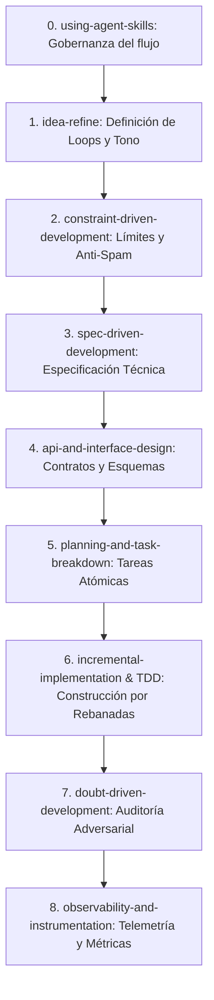

# Master Plan: Loops Proactivos y Radar "Wide & Fresh" en RICK Multitenant
## Framework de Ingeniería Basado en `Agent Skills`

> **Estado:** Propuesta de Plan para Revisión del Usuario.  
> **Modo:** Read-Only / No Auto-Proceed hasta contar con aprobación explícita.  
> **Fecha:** 19-oct-2026  

---

## 1. Visión y Requerimientos Estratégicos

El objetivo es dotar a RICK de **capacidad proactiva autónoma** y de un **radar de mercado sin solapamiento**, garantizando que:
1. **Identidad de Equipo:** RICK se comunica y razona como **miembro interno del equipo** (Head of Content / Productor Ejecutivo en la mesa de mezclas), no como un bot ni un consultor externo.
2. **Inactividad de 42 Horas al Final del Día:** El disparador de reactivación salta a las **42 horas** de silencio y se despacha exclusivamente en la ventana de **final de la jornada (17:00 a 19:30)** hora local.
3. **Inversión de la Ecuación del Radar ("Wide & Fresh"):** Se reemplaza el modelo obsoleto de *pocos creadores con muchos videos viejos* (3 creadores × 40 videos) por un modelo de *muchos creadores con pocos videos recientes* (15–25 creadores × 3–5 videos recientes con $R \ge 1.5x$), con memoria de rotación para evitar solapamientos y repeticiones.

---

## 2. Mapeo de `Agent Skills` por Fases del Ciclo de Vida



### Tabla de Responsabilidades por Skill

| Fase | Skill Invocada | Entregable / Responsabilidad en RICK |
| :--- | :--- | :--- |
| **Fase 0** | `using-agent-skills` | Regula la disciplina de desarrollo, prohíbe auto-proceeds y asegura que no se baje la barra de calidad. |
| **Fase 1** | `idea-refine` | Refina el tono ("RICK como socio de equipo") y la ecuación del radar amplio (15-25 cuentas). |
| **Fase 2** | `constraint-driven-development` | Fija contratos no negociables: umbral de inactividad = 42h, ventana horaria = 17:00-19:30, cooldown = 24h, max 3 posts/creador, SNR $\ge 0.85$. |
| **Fase 3** | `spec-driven-development` | Redacta las especificaciones funcionales de los 3 loops proactivos y del subsistema de radar desacoplado. |
| **Fase 4** | `api-and-interface-design` | Modela las interfaces Pydantic (`WideRadarConfig`, `ProactiveTrigger`, `RotationRegistry`, endpoints FastAPI). |
| **Fase 5** | `planning-and-task-breakdown` | Desglosa la implementación en rebanadas verticales con dependencias y criterios de verificación. |
| **Fase 6** | `incremental-implementation` + `test-driven-development` | Construye rebanada por rebanada con pruebas unitarias e integración en verde (`pytest`). |
| **Fase 7** | `doubt-driven-development` | Examen adversarial: ¿Qué pasa si una cuenta referente es borrada? ¿Qué pasa si el creador ignora 3 pings? ¿Cómo evitamos saturar tokens? |
| **Fase 8** | `observability-and-instrumentation` | Instrumenta logs estructurados, latencias y tasa de respuesta del usuario a los pings proactivos. |

---

## 3. Arquitectura Técnica de la Solución

### 3.1 Loop Engineering: Los 3 Loops Proactivos

1. **Loop 1: Brand Health & Pillar Alignment (`brand_health_audit`)**
   - **Gatillo:** Semanal (lunes por la mañana) o tras acumular 3 publicaciones nuevas del creador.
   - **Evaluación:** Compara temas recientes vs. pilares del Cerebro de Marca. Detecta abandono de pilares técnicos ("demostración de mecanismo") o deriva de voz.
   - **Voz de Equipo:** *"Oye Miguel, estuve revisando cómo cerramos la semana en el canal. Noté que tenemos desatendido nuestro pilar técnico de sistemas. ¿Armamos hoy una demostración del mecanismo para rebalancear la autoridad?"*

2. **Loop 2: Proactive Sparks de Mercado ("Wide & Fresh") (`market_spark`)**
   - **Gatillo:** Cuando el radar en background detecta un post anómalo ($R \ge 2.0x$) en el pool de 20 referentes.
   - **Evaluación:** Cruza el formato ganador con la tesis del creador, aplica anti-plagio ($<5$ palabras coincidentes) y verifica que el referente no haya sido usado en los últimos 7 días.
   - **Voz de Equipo:** *"Miguel, en el radar del equipo vimos que @creador pegó un 2.5x con este gancho. Lo bajé a nuestra tesis: '...'. Ya tiene tracción validada. ¿Le damos luz verde para el próximo guion?"*

3. **Loop 3: Indagación de Trinchera por Inactividad (`trench_inquiry`)**
   - **Gatillo:** Silencio del creador $\ge 42$ horas.
   - **Ventana de Entrega:** Estrictamente **17:00 a 19:30 hora local** (final de la jornada laboral).
   - **Evaluación:** Una sola pregunta mayéutica Rubin sobre la fricción o problema vivido en el día.
   - **Voz de Equipo:** *"Miguel, en el equipo llevamos casi dos días sin mover piezas. ¿Qué fue lo más frustrante o inesperado que te pasó hoy con un cliente o en tu código? Grábame 30s de nota de voz sin filtros; de ahí sacamos el próximo guion."*

---

### 3.2 Graph Engineering: Inversión de la Ecuación del Radar

Para evitar solapamientos y que RICK re-analice los mismos videos en cada llamada:

```
[Cron Nocturno / Background Worker]
                 │
                 ▼
    [🌐 Ingestion Radar: 20 Creadores × Top 3 Recientes]
                 │
                 ▼
    [🗄️ Supabase / Local Matrix Cache] (Indexado con post_id y R)
                 │
  ═══════════════╪══════════════════════════════════════════════════════
                 │ (Desacoplado: Cero scraping en tiempo real)
                 ▼
[Usuario pide Guion] o [Trigger Proactivo]
                 │
                 ▼
    [🛡️ Anti-Overlap & Rotation Filter]
        ├─ Descartar post_ids usados en últimos 30 días
        ├─ Aplicar cooldown a creadores usados en últimos 7 días
        └─ Priorizar creadores frescos del pool amplio (15-25 cuentas)
                 │
                 ▼
    [✍️ Guionista / Spark Node] (Generación instantánea <50ms)
```

---

## 4. Desglose de Tareas de Implementación (Task Breakdown)

### Rebanada 1: Configuración de Inactividad y Gobernador (`constraint-driven-development`)
- **Tarea 1.1:** Calibrar en el Gobernador (`governor.py`) la regla de 42 horas y la ventana horaria de 17:00 a 19:30 para `trench_inquiry`.
- **Tarea 1.2:** Implementar la prueba unitaria de validación de 42h y horario nocturno en `tests/test_governor.py`.

### Rebanada 2: Tono e Identidad de RICK como Miembro de Equipo (`idea-refine`)
- **Tarea 2.1:** Actualizar `RICK_CANONICAL_SYSTEM_PROMPT` en `src/agents/prompts.py` y nodos conversacionales (`rick.py`, `trench.py`, `spark.py`) eliminando cualquier tono de consultor lejano y reforzando complicidad de equipo.
- **Tarea 2.2:** Validar con tests conversacionales multi-turno que el agente no use fórmulas robóticas.

### Rebanada 3: Motor de Radar Amplio y Anti-Solapamiento (`api-and-interface-design` + `incremental-implementation`)
- **Tarea 3.1:** Implementar en `src/matrix/analyzer.py` el filtro `sample_wide_radar` (max 3 posts por creador sobre pool de 15–25 cuentas).
- **Tarea 3.2:** Implementar el registro de rotación y exclusión de posts ya utilizados (`rotate_creator_patterns` y memoria de cooldown).
- **Tarea 3.3:** Suite de pruebas en `tests/test_wide_radar.py` verificando diversidad, exclusión de duplicados y rotación equitativa.

### Rebanada 4: Desacople del Radar y Worker en Background (`ci-cd-and-automation`)
- **Tarea 4.1:** Crear el servicio de ingesta periódica `src/services/radar_ingestion.py` que alimenta la matriz en segundo plano.
- **Tarea 4.2:** Integrar con el endpoint de tick proactivo `POST /api/proactive/tick` en `src/api/app.py`.
- **Tarea 4.3:** Pruebas de integración E2E simulando el ciclo completo sin llamadas externas bloqueantes.

---

## 5. Criterios de Aceptación Globales (Definition of Done)

1. [ ] Cero solapamiento: Ningún guion o spark utiliza un video de referente usado en los últimos 30 días para ese usuario.
2. [ ] Diversidad amplia: El radar procesa un abanico de al menos 15 creadores con un tope de 3 videos recientes cada uno.
3. [ ] Cero scraping en el hilo de chat: La respuesta conversacional de WhatsApp ocurre en $< 1$ segundo consultando la matriz indexada.
4. [ ] Inactividad exacta: El ping de trinchera solo salta si han transcurrido $\ge 42$ horas y la hora local está entre las 17:00 y las 19:30.
5. [ ] Tono de equipo: El 100% de los mensajes de RICK reflejan identidad de socio interno de contenido.
6. [ ] 100% de la suite de pruebas automatizadas en verde (`pytest tests/`).
