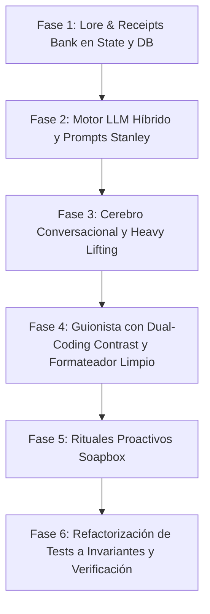

# Plan Maestro: Evolución RICK a Nivel Stanley (Human-First Generative Architecture)

> **Objetivo:** Eliminar la sobre-ingeniería determinista y las plantillas rígidas que vuelven a RICK robótico, restaurando la inteligencia conversacional, la memoria episódica ("Receipts Bank"), el contraste de codificación dual (Visual vs. Spoken Hook), los rituales Soapbox y tests basados en invariantes y estructura en lugar de strings fijos.

---

## 1. Diagnóstico y Decisiones de Arquitectura

| Problema Actual en RICK v1.1.0 | Causa Raíz | Solución Nivel Stanley |
| :--- | :--- | :--- |
| **Plantillas enlatadas y frases fijas** (`"radar del equipo"`, `"Cámara: Tono de café"`, `"¿Hacemos una sola pieza...?"`) | Tests unitarios exigían `assert "frase" in response`, forzando a los nodos a retornar `f-strings` estáticos. | Desacoplar tests de strings exactos; inyectar motor LLM con fallback mockeable para tests y prompts generativos fluidos. |
| **Enrutador de intenciones ciego** (`classify_intent` con 4 caminos rígidos) | Palabras clave fijas sin comprensión contextual ni manejo de meta-preguntas, objeciones o regateo. | Orquestador conversacional inteligente que responde preguntas meta, maneja objeciones y redirige al objetivo. |
| **Mayéutica burocrática** (exige `scene` y `root_friction` antes de escribir) | Si el usuario está bloqueado o tiene la mente en blanco, RICK lo interroga en vez de ayudar. | **Heavy Lifting**: Cuando el usuario duda o está en blanco, RICK propone 2 ángulos concretos de su propio `story_bank`. |
| **Cero memoria episódica viva** | Solo métricas abstractas (`mediana_views=12000`); no recuerda proyectos reales del creador. | **Lore & Receipts Bank**: Banco de 5 a 10 historias y anécdotas reales del creador (`story_bank`) usadas en cada respuesta. |
| **Guiones acartonados con humo de IA** | Bloques en mayúsculas `HOOK/DESARROLLO/CIERRE`, notas de cámara y probabilidad falsa `9.4/10`. | **Dual-Coding Contrast**: Visual Hook (texto en pantalla) vs. Spoken Hook (audio hablado), Information Gap y cero métricas falsas. |
| **Pings proactivos aburridos** | Mensajes mecánicos tipo informe corporativo. | **Rituales Soapbox**: Observación sobre la tesis del creador + Contraste con el 90% de la industria + CTA de audio de 20s. |

---

## 2. Mapa de Fases de Ejecución

---

## 3. Desglose Detallado de Tareas

### Fase 1: Memoria Episódica Real ("Lore & Receipts Bank")
- **Tarea 1.1:** Extender `CreatorProfile` y `GraphState` en `src/graph/state.py` con el modelo `StoryReceipt` (id, summary, theme, concrete_details, punchline).
- **Tarea 1.2:** Actualizar `src/db/repository.py` para almacenar y recuperar el `story_bank` de Supabase (y en memoria). Sembrar las historias reales de `@miguel_gomezpo` (AyudaSismo, automatización Excel de 30 min para clínica dental de su papá, creación de RICK e Ireal, reel de handoff.md, Bancolombia).

### Fase 2: Motor LLM Híbrido y System Prompt Maestro
- **Tarea 2.1:** Copiar/vincular `.env` a la raíz de `RICK Multitenant` y crear `src/services/llm.py` que soporte OpenAI (`gpt-4o`) y Gemini (`gemini-2.5-flash` / `gemini-2.5-pro`) con modo determinista/mockeable para ejecución instantánea en tests sin costo.
- **Tarea 2.2:** Rediseñar `src/agents/prompts.py` con el **System Prompt Maestro estilo Stanley**:
  - Tono humano, cómplice, directo, tuteo natural.
  - Regla innegociable: Anclaje constante en el `story_bank` del creador.
  - Manejo de objeciones y meta-conversaciones con redirección suave.
  - Eliminación de la limitación arbitraria de 60 palabras y de 1 sola pregunta obligatoria.

### Fase 3: Cerebro Conversacional & Mayéutica Proactiva ("Heavy Lifting")
- **Tarea 3.1:** Refactorizar `src/agents/rick.py` para liberarlo de los condicionales rígidos de `scene_markers` y `friction_markers`.
- **Tarea 3.2:** Implementar la lógica de asistencia activa: si el creador dice "no sé qué grabar", "mente en blanco" o duda, RICK le pone 2 opciones sobre la mesa extrayendo de su propio `story_bank`.
- **Tarea 3.3:** Permitir respuestas ricas cuando el usuario pregunta sobre arquitectura, psicología de contenido o metodología.

### Fase 4: Guionista con Dual-Coding Contrast y Formateador Desintoxicado
- **Tarea 4.1:** Actualizar `src/agents/guionista.py` para generar guiones con el framework de 4 pasos:
  1. Payload (la verdad o lección de trinchera).
  2. Creencia de consenso a quebrar.
  3. Colisión en <10 palabras.
  4. Dual-Coding: Visual Hook (texto en pantalla) vs. Spoken Hook (lo que dice en voz alta).
- **Tarea 4.2:** Limpiar `src/graph/formatter.py`:
  - Eliminar la simulación falsa `"💡 Lo calibré contra 5 videos... 9.4/10"`.
  - Eliminar acotaciones vacías tipo `(Cámara: Tono de café)`.
  - Formato limpio y legible directamente en WhatsApp/Telegram.
- **Tarea 4.3:** Simplificar el loop de `evaluator.py`: si el script viene generado con las directrices anti-slop y el story bank inyectado, no degradar la personalidad con 3 ciclos de reescritura forzada.

### Fase 5: Rituales Proactivos Soapbox
- **Tarea 5.1:** Refactorizar `src/agents/spark.py`, `src/agents/trench.py` y `src/agents/brand_health.py`.
- **Tarea 5.2:** Reemplazar las plantillas burocráticas por el formato **Soapbox de Stanley**:
  - Elogio/observación aguda sobre el instinto del creador.
  - Contraste contra el 90% de la industria.
  - Llamado a la acción de baja fricción: nota de voz de 20-30 segundos.

### Fase 6: Modernización de la Suite de Tests & Verificación E2E
- **Tarea 6.1:** Refactorizar `tests/test_conversation_ux.py`, `tests/test_rick_node.py`, `tests/test_rick_sagas_ux.py`, `tests/test_guionista.py`.
- **Tarea 6.2:** Eliminar todos los asserts de coincidencia de string exacta (`"radar del equipo"`, `"¿Hacemos una sola pieza..."`, `res2.count("?") == 1`, `"Cámara:"`).
- **Tarea 6.3:** Reemplazarlos por asserts de invariantes de arquitectura: aislamiento multi-tenant, persistencia, generación de campos estructurados, gobernanza anti-spam y verificación anti-slop.
- **Tarea 6.4:** Ejecutar la suite completa y certificar que los 96+ tests pasan con éxito.
