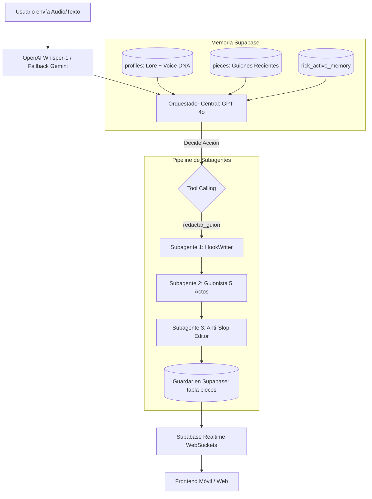
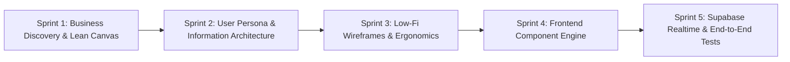

# 🏛️ Arquitectura Técnica de RICK & Especificación para Diseñadores Frontend

---

## 📂 1. Contexto de Carpetas y Separación de Responsabilidades

Para no contaminar el motor de producción ni mezclar librerías de Python con Node.js, el ecosistema de RICK se organiza en **dos dominios independientes**:

```
RICK Multitenant (Raíz del Workspace)
│
├── 🧠 RICK! Guía de Marca Personal/   <-- BACKEND MOTOR (Python 3.11 / FastAPI / Docker)
│   ├── src/
│   │   ├── engine/                   <-- Orquestador, Tools, Subagentes (HookWriter, Guionista, Anti-Slop)
│   │   ├── services/                 <-- Telegram Bot, WhatsApp Cloud API, Instagram Radar
│   │   ├── api/                      <-- Servidor FastAPI (endpoints /health y webhooks)
│   │   └── db/                       <-- Cliente Supabase y migraciones SQL
│   ├── Dockerfile & docker-compose.yml
│   └── tests/                        <-- 48 tests unitarios pasando
│
└── 💻 rick-studio-frontend/           <-- FUTURA APP FRONTEND (Next.js / React / Tailwind)
    ├── src/components/               <-- Componentes visuales UI
    ├── src/hooks/                    <-- Conexión a Supabase Realtime y audio
    └── package.json                  <-- Dependencias web aisladas
```

> **Regla de Oro para Diseñadores y Desarrolladores Frontend:**  
> La carpeta `RICK! Guía de Marca Personal` es el **servidor de inteligencia**. La app web/móvil se desarrollará en su propia carpeta limpia (`rick-studio-frontend`) consumiendo la API de FastAPI y la base de datos de Supabase.

---

## ⚙️ 2. ¿Cómo funciona RICK por debajo? (Backend Engine)

Cualquier diseñador o programador de UI debe entender el flujo de datos exacto de RICK:



### El Pipeline de los 3 Subagentes
1. **HookWriter:** Analiza el brief del creador y genera 3 opciones de ganchos con quiebre cognitivo (Contracorriente, Pregunta Incómoda, Escena en Movimiento).
2. **Guionista Maestro:** Desarrolla los 5 actos del guion (Gancho, Problema, Tensión/Solución, Conclusión, CTA) incorporando direcciones de cámara y psicología.
3. **Anti-Slop Editor (Humanizer):** Audita el texto, elimina clichés de inteligencia artificial y calibra la cadencia a la voz humana del creador.
4. **Persistencia:** Guarda la pieza final en la tabla `pieces` de Supabase con estado `draft` o `ready`.

---

## 🗄️ 3. El Modelo de Datos de Supabase (Data Layer)

El diseñador de frontend interactúa con las siguientes tablas clave en Supabase:

### Tabla `pieces` (Guiones y Contenido Generado)
* `id` (`uuid`): Clave primaria única del guion.
* `user_id` (`uuid`): ID del creador dueño de la pieza.
* `title` (`text`): Título conceptual de la idea.
* `format` (`text`): `reel` | `tiktok` | `carousel` | `youtube_short`.
* `framework` (`text`): `pas` | `storytelling` | `contrarian`.
* `content` (`text`): El guion completo estructurado en actos con acotaciones.
* `hook_text` (`text`): El gancho de 3 segundos seleccionado.
* `cta_text` (`text`): La llamada a la acción final.
* `status` (`text`): `idea` | `in_progress` | `ready_to_record` | `recorded` | `published`.
* `created_at` (`timestamptz`): Fecha de creación.

### Tabla `profiles` (Identidad y Lore del Creador)
* `id` (`uuid`): Clave primaria vinculada a `auth.users(id)`.
* `handle` (`text`): Nombre de usuario (ej. `@miguel_gomezpo`).
* `lore` (`text`): Manifiesto, anécdotas, victorias, fracasos y reglas de negocio del creador.
* `voice_dna` (`text`): Tono, vocabulario prohibido y estilo de comunicación.
* `positioning` (`text`): Nicho de mercado y propuesta de valor única.
* `onboarding_status` (`text`): `not_started` | `in_progress` | `completed`.

### Tabla `rick_active_memory` (Contexto en Vivo)
* `user_id` (`uuid`): Clave primaria.
* `state` (`jsonb`): Tópico activo, etapa de la conversación, serie actual.
* `summary` (`text`): Resumen comprimido de turnos pasados.

---

## 🌐 4. Especificación de Endpoints (API Contracts)

El backend de FastAPI corre en el Droplet (`68.183.30.218:8000`).

### Endpoints Actuales de Producción:
* `GET /health`: Estado del sistema, conexión a Supabase y modo (`production`).
* `POST /webhook/whatsapp`: Endpoint oficial para webhooks de Meta WhatsApp Cloud API.

### Endpoints Diseñados para la App Frontend:
* `POST /api/v1/chat/message`:
  * **Payload:** `{ "user_id": "...", "message": "...", "stream": true }`
  * **Respuesta:** Stream de texto con **Server-Sent Events (SSE)** token a token + eventos de subagentes (`hook_writing`, `script_drafting`, `refining`).
* `POST /api/v1/audio/transcribe`:
  * **Payload:** `multipart/form-data` con archivo de audio (`.ogg`, `.mp3`, `.m4a`).
  * **Respuesta:** `{ "transcription": "...", "duration_ms": 650 }`.
* `GET /api/v1/creators/{user_id}/pieces`:
  * **Respuesta:** Lista paginada de guiones para alimentar las tarjetas del frontend.
* `PATCH /api/v1/pieces/{piece_id}`:
  * **Payload:** `{ "content": "...", "status": "ready_to_record" }`.
  * **Efecto:** Actualiza el guion y dispara notificación en tiempo real a Telegram/WhatsApp.

---

## 🗓️ 5. Metodología de Desarrollo en Sprints (Cero "One-Shot")

Para garantizar que el producto esté sólidamente fundamentado y no caiga en sesgos de IA, el desarrollo se divide en **5 Sprints iterativos a lo largo de varias sesiones**:



* **Sprint 1: Fundamentación de Negocio (`interview-me`)**
  * Entrevista estructurada para definir **Product Canvas** y **Lean Canvas**.
  * Definición del cliente ideal, canales, fuentes de ingresos y métricas clave.
* **Sprint 2: Arquitectura de Información y Persona**
  * Mapeo de flujos sin código: ¿Qué ve el creador en el segundo 1 de abrir la app?
  * Glosario y modelo mental del usuario no técnico.
* **Sprint 3: Wireframes de Baja Fidelidad y Ergonomía**
  * Bocetos estructurales en blanco y negro (sin distracciones estéticas de colores).
  * Validación de la zona del pulgar y navegación por hojas inferiores (bottom sheets).
* **Sprint 4: Construcción de la App Frontend (`frontend-ui-engineering`)**
  * Setup de `rick-studio-frontend` con Next.js 15, Tailwind y componentes modulares.
  * Conexión de audio con Whisper y streaming de texto.
* **Sprint 5: Sincronización en Tiempo Real y QA**
  * Suscripción WebSockets con Supabase Realtime.
  * Pruebas en dispositivos móviles reales con Chrome DevTools.
